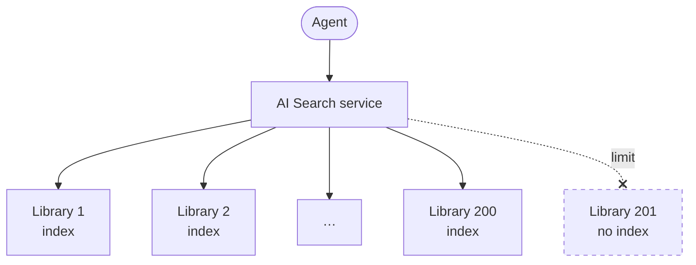
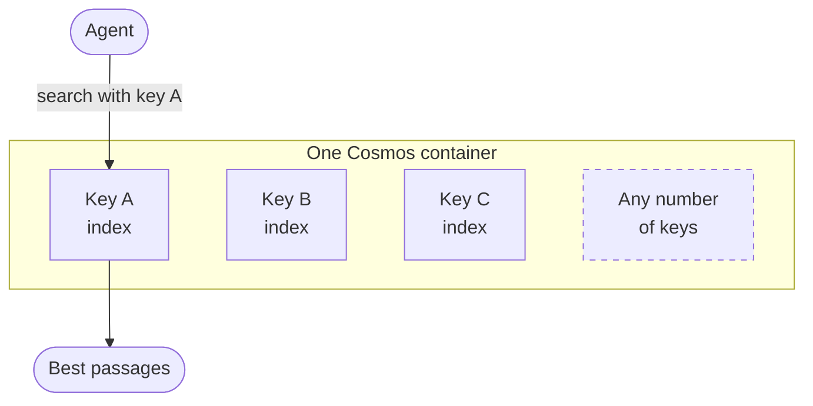
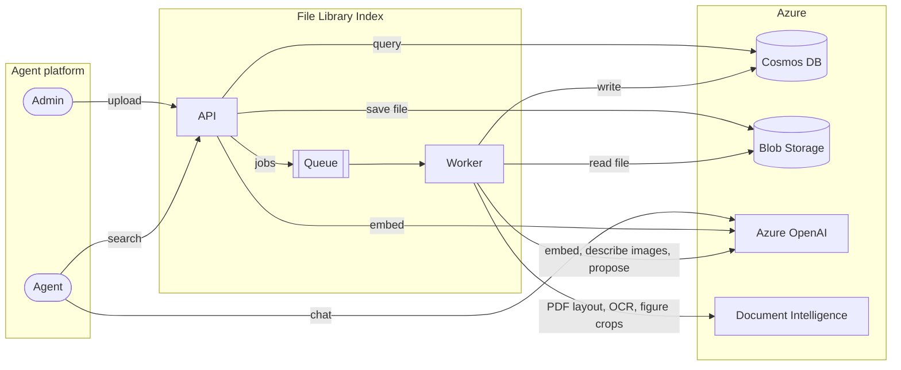
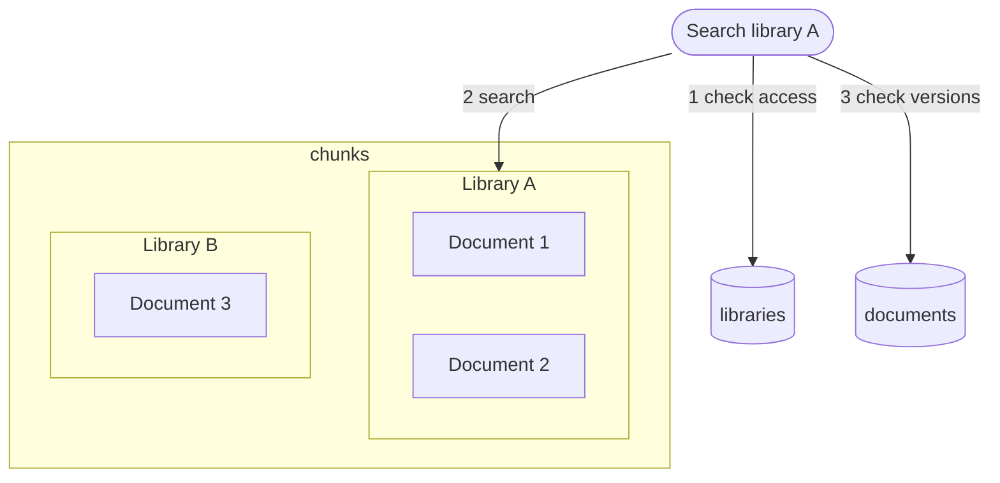

# Cosmos DB Key-Based File Libraries
*Working name.*


*From Seabrook Lab*

A search service that stores agent file libraries in Azure Cosmos DB instead of Azure AI Search.

The [specification](docs/spec.md), [build plan](docs/build-plan.md) and [current retrieval contract](docs/agent-retrieval.md) describe the implementation. The [planned retrieval roadmap](docs/consults/2026-10-27-retrieval-roadmap.md) records the next priorities. The [test/evidence pack](docs/testing/2026-10-27/README.md) includes the exact corpus, questions, sanitized observed answers/traces and review figures.

- Admins and users upload files into libraries.
- Cosmos stores searchable text passages and image descriptions, vectors and metadata. Blob holds originals, complete extracted text and image/caption assets; selected figures can appear inline with an answer.
- Agents combine passage search, complete-document reads and stored PDF figure reads through tools the platform attaches to them.
- Personal agents each get their own library, which no other agent can search.

It removes the limit that prompted it. Azure AI Search allows 200 indexes per service on the S2 and S3 tiers, and the current design uses one index per library. Here a library is a value stored on each record, not an object the service counts, so creating a library does not consume an index slot. Throughput, storage and practical scale still need capacity planning and measurement.

## Why one Cosmos container

Using Azure AI Search, every library would be its own search index, and the search service counts indexes. Under this alternative, every library lives in one Cosmos DB container: each passage of each document is stored with its text, its meaning as a vector, and the ID of its library. Cosmos keeps each library's passages together and builds a separate vector index for each library inside that one container. A search names one library, so it reaches only that library's passages and that library's index.

**Today.** One Azure AI Search index per library, and the service stops at 200.



**Proposed.** One Cosmos DB container. The library is a key on each passage, and each key gets its own vector index.



What this arrangement buys, with the measurements behind it (`docs/evidence.md`):

| Goal | How the container delivers it | Measured |
|---|---|---|
| **Accurate semantic search** | Each library has its own vector index, so a search compares the question's meaning against that library's passages only. Filters run inside the same query, and a replaced document's old version is never returned. | Per-owner vector indexes kept recall@10 at 0.991 against exact search (E2). Half-precision vectors lost no accuracy: 0.980 against 0.980 (E7). |
| **Fast** | The library ID leads the container's partition key and is its vector shard key, so a search goes to one library's data and one index, in one round trip. | 97–127 ms server latency at the 95th percentile, against 143–295 ms without per-owner indexes (E2). |
| **Cheap** | A search's cost follows the size of the library searched, not of the container. Half-precision vectors and serverless billing keep the rest small. | 54–69 RU per search at the 95th percentile, against 407–1,063 (E2). 8–16 RU per search on a 5,535-passage library here, 4–7 RU filtered: about $4 per million searches at serverless prices (E10). |
| **No index-per-library ceiling** | A library is a value on each record. Cosmos counts containers (500 per account), never values, so adding a library creates nothing it counts. | Azure AI Search allows 50 indexes on S1 and 200 on S2 and S3 (E1). Phase 4 puts 1,000 libraries in one container and checks search cost is unchanged. |

The arrangement pays off only when every search names exactly one library. Searching without the library ID cost about 220 times more, and one query across several libraries about 300 times more (E4, E5). So the service always takes the library ID from the URL the platform called, and searches several libraries as several queries.

The latency and per-owner figures come from earlier measurements of the same Cosmos features on a container of 2,000 owners' content, which this design applies to libraries. That libraries behave like those owners is an inference until Phase 4 measures it (N2).

## Status

An isolated [structured-retrieval lab](docs/structure-lab.md) now compares shared
and separate Cosmos summary indexes using frozen source trees, summaries and
vectors. Its three index canaries and initial live functional demonstration
passed. The normal API/worker are unchanged; representative quality/scale tests
and Microsoft ingestion-preview compatibility are the next steps.

Phases 0–3 of `docs/build-plan.md` have passed on live Azure.

- Phase 0: the Cosmos configuration deployed and passed its canary at small scale (`records/`).
- Phase 1: the API, ingestion worker and vector search work end to end, and a personal library refuses other agents.
- Phase 2: a demo platform (Streamlit) runs official and personal agents that search their libraries through tools.
- Phase 3: metadata filters (period, dates, authors, tags, file types), AI proposals of tags, periods, authors and library descriptions for an admin to accept, and document replacement and deletion.

Phase 3B image support is implemented and smoke-tested for standalone uploads, Word/PowerPoint pictures and individual PDF figure crops with linked captions (including vector charts and scanned illustrations). The current local suite passes 581 tests; live checks cover ingestion, stored-caption retrieval, inline display and lifecycle protection. These are prototype checks, with broader retrieval and figure/caption accuracy evaluation still pending; see [image retrieval](docs/image-retrieval.md) for the platform contract and limits. Phase 4 (a thousand libraries in one container, measured) remains. The design rests on earlier measurements of these Cosmos features on live Azure (2026). `docs/evidence.md` traces each decision to them and lists what is not yet proven.

## Prototype choices and production boundaries

This repository is a working reference implementation. Its demo limits describe this implementation, rather than ceilings imposed by Cosmos or requirements for every consuming platform.

| Area | Current prototype | Production interpretation |
|---|---|---|
| Image work | Defaults: 50 described/indexed images and 1,000 stored source assets per document | Configurable cost/coverage bounds (`IMAGE_MAX_PER_DOCUMENT`, `IMAGE_ASSET_MAX_PER_DOCUMENT`), not Cosmos image limits. The current asset safety maximum is 10,000; changing it requires code and capacity review. |
| File and page bounds | 100 MiB default upload limit; PDF layout up to 2,000 pages, in batches of 20 | Upload/batch limits are deployment settings; 2,000 is the implementation's current PDF maximum. Production must size memory, provider limits, timeouts and quotas together. |
| Targeted figure reads | 1–10 selected image IDs across supported formats, or 1–3 PDF pages (up to 10 figures) | Existing manifests enable direct reads, including retained unindexed Office pictures. Missing legacy provenance is disclosed. |
| Image delivery | 15-minute read-only user-delegation SAS links | Current delivery policy. A production platform can choose another appropriate lifetime or authorized proxy/cache; preserve scoped access and keep bearer links out of logs/public content. |
| Chat and rendering | Streamlit, `fli-image` markers, a preview when an image leads the search ranking, conservative image-token estimates and a session cache | Demo adapter conventions. A consuming platform owns answer composition, visual inputs, rendering, context budgets and authorized conversation storage. |
| Context budgets | Demo context defaults to 64,000 tokens; complete reads default to 32,000 with a 200,000-token API maximum | Model/platform budgets and current API bounds, not Cosmos limits. Production chooses its own usable context and visual-token accounting while preserving explicit completeness. |
| Models and indexing | Image meaning is represented by generated text, embedded in the same vector space as passages | This is description-based retrieval. Model deployments and budgets can change; embedding-model/vector-policy changes need a validated index rebuild. No native image embeddings are claimed. |
| Runtime and capacity | Local API/worker, process-local governors, serverless Cosmos and an optional local metrics journal | Production needs hosted workers, aggregate capacity control, production authentication, monitoring and measured throughput. Laptop sleep can interrupt the local demo; durable checkpoints let processing resume. |
| Quality and latency | Small real-model/source checks plus local regressions | No guarantee that every figure/caption is detected, every model picks the right image, or answers finish in a fixed time. Figure/page correspondence, semantic recall and end-to-end model behavior need representative evaluation. |

The intended production contract is accurate source provenance, paired image/caption evidence, explicit omissions/completeness, authorized library scope and safe publication across retries/replacements/deletions. Production may replace or tune the prototype's orchestration and presentation while preserving those properties. A text result need not automatically attach nearby pictures, and the agent remains responsible for choosing a relevant illustration.

Phases 4–5 cover scale proof, production deployment/authentication, operational recovery and broader quality evaluation. Known cross-client Session-consistency limits still apply; current lifecycle rereads are not proof of immediate visibility across independent API instances. See the [readiness review](docs/consults/2026-10-27-image-readiness-review.md) and [scale limits](docs/capacity/untested-at-scale.md).

## Complete documents and supporting passages

Agents can find files by name or metadata, read one or several complete extracted documents, and combine them with relevant passages from other files in the same question. They can alternate between complete reads and passage searches in either order, without routine user confirmation. The library service presents both options with size, completeness, provenance, budget and retrieval-cost information; agent builders and library owners supply the guidance that shapes scope decisions.

The `/tools` bundle exposes discovery, full reads, passage search and stored PDF page-image reads. Full reads report size and completeness and return no text when a complete selection cannot fit; they never silently clip a file. Existing files remain readable as complete indexed passages, with overlaps disclosed; new ingestion preserves the extraction before chunking. Text extraction retains its existing visual and attachment limitations.

Both explicit mixed-retrieval sequences passed against live Azure and a real model. In a later manual pair, mixed retrieval reduced input to the final answer call by 37.3%, while cumulative tokens, retrieval RU and retrieval time increased; the runs used different wording, so this is composition evidence rather than a controlled cost, speed, attention or accuracy result. Human answer-quality review and broader agent-routing evaluation remain pending. See [the API, integration and rollout notes](docs/document-retrieval.md) and the [comparison record](records/full-vs-mixed-retrieval-20261026.json).

## Images alongside text

Semantic retrieval searches text passages and generated image descriptions together. Images carry their source captions, document/page or slide location, and expiring read links. Agents can place a relevant chart, illustration or map inline with an explanation, with its caption by default; the platform controls rendering. A text passage does not automatically attach every nearby image. For a relevant PDF figure absent from search, the agent can read stored figures and page text directly.

Ingestion separates page text from figure crops and associates captions before publication. Mixed documents publish complete extracted text and embeddings first; deferred image descriptions then extend the same generation without re-embedding text. Image/caption reads perform no layout analysis, image descriptions or answer-rewriting pass. Separate source-storage and description caps bound work and disclose omissions. See [image retrieval](docs/image-retrieval.md) for integration, configuration, upgrade steps and limits.

## Prototype performance views

Chat shows retrieval RU/time, total response time and actual cumulative model token use, with per-call breakdowns and quota-wait timing. **Library Performance** shows current document/chunk/vector inventory, captured ingestion/embedding measurements and a bounded retrieval log with RU, latency, results and calling agents. Old measurements are shown as unavailable. Runtime telemetry stays outside the reference repository. See [observability.md](docs/observability.md) for setup, exclusions and the prototype/production boundary.

## What's here

| Path | What it is | For |
|---|---|---|
| `docs/brief.md` | The case for the change, in two pages | Anyone deciding whether to adopt it |
| `docs/observability.md` | Prototype performance views, metric definitions, exclusions and telemetry setup | Azure architects and AI developers |
| `docs/image-retrieval.md` | Figure/caption ingestion, semantic retrieval, inline rendering, processing bounds and rollout | Platform integrators and reviewers |
| `docs/document-retrieval.md` | Passage/full-file selection, mixed retrieval, API contracts, agent guidance and rollout | Platform integrators and reviewers |
| `docs/agent-retrieval.md` | Current file discovery, scoped evidence retrieval, bounded reads and selected-image inspection contract | Platform integrators and developers |
| `docs/consults/2026-10-27-retrieval-roadmap.md` | Planned compact REST responses, shared section summaries and document summaries, in priority order | Developers and product reviewers |
| `docs/testing/2026-10-27/` | Reproducible retrieval corpus, questions, observed results and evaluation limits | Developers and reviewers |
| `docs/spec.md` | What to build: components, data model, permissions, API, ingestion, search | Whoever builds it |
| `docs/build-plan.md` | Build order, demo-first, with an exit check per phase and the demo script | Whoever builds it |
| `docs/evidence.md` | Each decision, the measurement behind it, and what is not proven | Reviewers, and anyone challenging a decision |
| `docs/review-response.md` | Each finding of the independent architecture review, its class, and what was done | Reviewers |
| `docs/capacity/provisioned-throughput.md` | Why production runs on provisioned throughput although the demo is serverless, with sizing and switching guidance | Anyone planning a production deployment |
| `docs/capacity/untested-at-scale.md` | What is not yet tested at the high end: a busy library's throughput ceiling, how many libraries one container holds, several physical partitions | Reviewers, and anyone planning for a large organization |
| `cosmos/*.json` | The three Cosmos container definitions, ready to deploy | Infrastructure code |
| `infra/` | Bicep for one organization's deployment, and how to deploy it | Whoever deploys it |
| `src/fli/` | The application package: `fli-api` and `fli-worker` entry points | Whoever builds it |
| `src/fli_demo/`, `demo/` | The demo platform: the index client, the agent–library attachments (kept outside the index) and the agent loop; the Streamlit pages | Anyone running the demo |
| `scripts/canary.py` | Proves a newly deployed account's vector and hybrid search work (CLAUDE.md rule 11) | Whoever deploys it |
| `scripts/load_demo_corpus.py` | Loads a folder of documents into shared libraries through the API | Anyone running the demo |
| `scripts/sample_docs/` | Generates invented, multi-format upload fixtures for functional hand-testing | Anyone checking file handling; not a search-quality corpus |
| `scripts/deployment_env.py` | Prints a deployment's outputs as `export` lines, for the demo commands below | Anyone running the demo |
| `scripts/phase1_exit.py`, `scripts/phase3_exit.py`, `scripts/phase3b_exit.py` | Exit checks driven through the running API; each writes a record to `records/` | Whoever runs an exit check |
| `records/` | Canary and exit-check records, committed | Reviewers |
| `CLAUDE.md` | Rules for coding agents working in this repo | Coding agents |

## Getting started

1. Read `docs/spec.md`.
2. Read `docs/build-plan.md` for what each phase built and which phase is current.

Set up and run every test (Python 3.12 or later; developed on 3.14):

```bash
python3 -m venv .venv && .venv/bin/pip install -e '.[dev,demo]'
.venv/bin/python -m pytest
.venv/bin/ruff check . && .venv/bin/ruff format --check .
```

Unit/API tests use in-memory services and need no Azure credentials. Live Cosmos ranking cannot be reproduced by the emulator; local tests check query construction and invariants, while canary/integration runs measure deployed behavior. The [test pack](docs/testing/2026-10-27/README.md#reproduce-the-scenarios) explains how to reproduce the recorded retrieval scenarios.

To deploy and run the canary, follow `infra/README.md`.

## Prototype setup

How the prototype is built and run for the demo: every component, what runs where, and the exact Cosmos layout. The section above says why; this one says precisely what.

### Components and workloads

The index is two processes, an API and an ingestion worker, in front of Azure services. Both authenticate with Entra ID only: a user-assigned managed identity when deployed, your `az login` when run locally. Keys are disabled on Cosmos, Blob Storage, Service Bus, Azure OpenAI and Document Intelligence. The platform keeps agents and which libraries they may use (in the demo, Streamlit stands in for it), so the index stores no permissions beyond who owns a personal library.



| Box | What it is | Its job |
|---|---|---|
| Admin, Agent | The platform's pages and agent loop; in the demo, Streamlit (`demo/`) | Create libraries, upload, review proposals; answer questions with search, discovery, full-read and stored PDF image tools per attached library |
| API | `fli-api` (FastAPI); local today, Container Apps in Phase 5 | Libraries, documents, search, tool definitions; checks a personal library belongs to the agent searching |
| Queue | Service Bus queue `ingest`, one session per library | Work for the worker; one library at a time per lane, up to 8 libraries at once |
| Worker | `fli-worker` | Extract text/figures/captions, publish text, describe/index images, propose metadata, retag and purge |
| Cosmos DB | NoSQL, serverless, vector search, continuous backup | Libraries, documents and passages ([detail below](#the-cosmos-containers-in-detail)) |
| Blob Storage | Container `files` | Original files, extracted text, cropped images, paired caption manifests and ingestion checkpoints per generation |
| Azure OpenAI | `text-embedding-3-large` (3,072 dimensions) and a chat deployment | Vectors for passages and questions; proposed tags, periods, authors and descriptions; the demo agent |
| Document Intelligence | `prebuilt-layout` with figure output | PDF text, tables, captions and individual figure crops |

Application Insights is deployed too; search events start arriving in Phase 4.

**Upload.** The API stores the original in Blob Storage under its own generation's path, writes the document record as `queued`, and puts an `ingest` message on the queue with the library as its session. One library's messages run one at a time, so a user dropping 5,000 files occupies one lane, while up to 8 libraries ingest in parallel.

**Ingest.** The worker reads the original and extracts its text (layout analysis with OCR, figure crops and captions for PDFs), chunks it into about 500 tokens per section, and asks the chat model for tags, a period and an author. For mixed documents it embeds and publishes text plus stored source image/caption assets first, then queues slower image descriptions and embeddings. Final enrichment appends image chunks without rewriting published text. Publication switches search to the new generation; a `purgeDocument` message removes obsolete generations. The library's tag vocabulary and filter values are recomputed, and a library description is proposed when enough has changed.

**Images.** Source crops and caption metadata are stored once. The worker describes/indexes up to 50 qualifying images per document by default and retains up to 1,000 source assets. PDF page reads can return stored figures beyond the description cap, without another model or layout call. Images and text share the existing Cosmos vector space and library filter. No new Cosmos container or index is required.

**Search.** An agent's tool call carries only a question and filters. The platform maps the tool to the library it attached and calls `POST /v1/libraries/{id}/search` with the agent's id. The API point-reads the library and refuses a personal library to any other agent, embeds the question, and runs one Cosmos query scoped to that library. It drops chunks of replaced or deleted documents and returns text and image passages with file, page or slide, and a coverage note saying what the filters left out.

**Discover and read.** The platform attaches the library-bound tools from `GET /v1/libraries/{id}/tools`. An agent can enumerate documents by name or metadata, use passage search to identify likely files, inspect full-text size, and read one or more complete extractions. It can then search other files for supporting passages or read more files as needed in the same question. The library service supplies the operations, completeness and budget limits; the consuming agent's builder and library owner guide how it chooses among them.

**Metadata changes.** Accepting a proposal or editing a document's tags updates the document record at once and queues `retag`, which copies the metadata onto every chunk so filters run inside the vector query.

### The Cosmos containers in detail

Three containers in one database. Everything is keyed by library first, because every operation names exactly one library: a search, an upload, a permission check. A library is a value on each record, not a container or index, so there is no count to run out of.



| Container | Partition key | One record per | Holds |
|---|---|---|---|
| `libraries` | `/libraryId` | library | Shared or personal, the bound agent, description and its proposal, tag vocabulary, stats |
| `documents` | `/libraryId` | document | Status, versions, file details, author, period, tags, proposals |
| `chunks` | `/libraryId`, then `/documentId`; vector index sharded by `/libraryId` | text or image passage | Text/image description and its page or slide; a 3,072-dimension float16 vector; copies of the document's author, period, tags and file type, for filtering |

The default vector search is one ranked query, sent with the library as its partition-key prefix: `SELECT TOP n … WHERE c.libraryId = @libraryId AND filters ORDER BY VectorDistance(…)`. Before it, the API reads the library record to check access. After it, it reads the documents of the hits and drops passages from replaced versions or unpublished enrichment. Image results receive fresh read links and an additional lifecycle check. Hybrid mode retains its separately measured routing/cost behavior (E27).

| What libraries need | How the containers provide it |
|---|---|
| Any number of libraries | A library is a partition-key value. Adding one creates no container, index or account object. |
| A search touches one library only, at a cost that does not grow with the others | `/libraryId` leads the `chunks` key, so the query goes straight to that library's data, and the vector shard key gives each library its own DiskANN graph. Searching several libraries is several queries, never `IN` or `OR` (E4, E5). |
| Personal stays personal | The library record holds `kind` and `boundAgentId`, both immutable. A personal library is searched only with its bound agent's id, checked on every search. |
| Cheap work per document | `/documentId` second in the key makes reprocessing, deleting or reading neighbouring chunks a single-partition operation, and keeps each logical partition far below Cosmos's 20 GB limit. |
| Filters inside the vector search | Each chunk carries a copy of its document's author, period, tags (`facets`) and file type, and those paths are indexed, so one query filters and ranks together. `retag` keeps the copies current. |
| Replace a document without a gap or stale answers | Chunk ids carry a generation. The old generation stays searchable until the new one commits; search keeps only the document's active generation, and the purge deletes the rest. |
| Keep costs low on serverless | float16 vectors cut storage by 46% and query cost by about 41% at equal recall (E7), provided the query vector is declared float16 too (E8). A search cost 8–16 RU on a 5,535-chunk library in Phase 1. Writes are the expensive side, about 144 RU per chunk, so the worker caps them across all libraries (E10). |

Vector settings (dimensions, data type, quantizer, shard key) cannot change after a container is created, so the chunk text and original files are kept: a change means a new container, rebuilt from them (E16).

## Run the demo

The demo runs locally against a deployed environment, signed in with `az login`. Choose a random local API key; it only protects the API on your machine. Run each command in its own terminal, from the repo root, after setting `RG` (the deployment's resource group) and `DEV_API_KEY` in that terminal.

```bash
eval "$(.venv/bin/python scripts/deployment_env.py -g "$RG")" && ENVIRONMENT=local AUTH_MODE=dev .venv/bin/fli-api
```

```bash
eval "$(.venv/bin/python scripts/deployment_env.py -g "$RG")" && ENVIRONMENT=local AUTH_MODE=dev .venv/bin/fli-worker
```

```bash
.venv/bin/python scripts/load_demo_corpus.py <corpus folder>
```

```bash
eval "$(.venv/bin/python scripts/deployment_env.py -g "$RG")" && .venv/bin/streamlit run demo/app.py
```

The corpus folder holds `groups/<library name>/` subfolders, one shared library each. Agents and their attachments are stored in `~/.fli-demo/state.json` (`DEMO_STATE_FILE` to change it), never in the index. Newly published content is searchable immediately; load documents a few minutes before measuring steady-state search cost because the vector index engages minutes after writes (`docs/evidence.md` E25).

## Synthetic upload fixtures

The existing sample-document generator is included for functional hand-testing of uploads, formats, metadata and failure handling. Install with `python -m pip install -e '.[samples]'`, then run `python -m scripts.sample_docs.build`. It writes an ignored `sample-docs/` directory with a manifest and answer key. An optional output-directory argument is supported; **the generator replaces that directory if it already exists**. Use a dedicated disposable directory.

These invented fixtures are not the real-document demo corpus and must not be used to claim semantic-search quality, recall or production performance. The evidence above uses real documents.

## Validate image support and prepare a change

With the API and worker running and deployment settings loaded, follow the [image smoke-check instructions](docs/image-retrieval.md#processing-isolation-and-verification). Keep the `--state` file outside the repository; repository records contain only sanitized counts, hashes, metrics and outcomes. The user-supplied dinosaur exchange remains in the [image guide header](docs/image-retrieval.md).

Before committing, run the local suite, lint/format checks above and `python scripts/check_reference_privacy.py`. An optional private `--deny-file` strengthens the environment-identifier check. CI runs Python 3.12 and 3.14 without Azure credentials; live records supplement those tests. See the [final image review](docs/consults/2026-10-27-image-readiness-review.md) for the implementation decisions, completed checks and remaining work.

Retrieval efficiency follow-ups add parent-file size hints and optional document grouping in search, interleave figures in new complete-read snapshots, compact demo model evidence, and describe images concurrently within the existing quota. They preserve whole-file completeness, captions, text-first publication and library isolation. See the [review decisions and validation](docs/consults/2026-10-27-retrieval-followups.md). The opt-in [compact REST contract](docs/compact-rest.md) now supports evidence, attachments and metadata across all retrieval operations, and the demo consumes it. Raw REST remains compatible; no re-upload or index change is required. Recall-sensitive embedding changes remain later work.

Subsequent human-run paired and casual tests exposed remaining agent-integration gaps, including inappropriate document grouping, ambiguous visual references and unnecessary follow-up requests before showing useful figures. See the [2026-10-27 test review](docs/consults/2026-10-27-agent-retrieval-test-review.md) for recorded evidence and the [proposed retrieval strategy](docs/consults/2026-10-27-agent-retrieval-strategy.md) for the reviewable next steps. The user subsequently authorized implementation; the [current tool contract](docs/agent-retrieval.md) records the implemented capabilities and remaining validation limits.

Natural-test follow-ups implement the [agent evidence contract](docs/agent-retrieval.md): explicit file finding versus passage evidence, scoped searches, bounded source expansion, cross-format image inspection and reference-adapter progress/follow-up handling. Refresh API/adapter/tool definitions; compatible existing source artifacts need no re-ingestion.

When deploying Python changes to the API or demo adapter, restart the affected API and Streamlit processes. A browser reload or Streamlit **Rerun** can leave imported Python modules and cached clients from an older version in memory. After tool/signature changes, restart both processes together. The library contents and agent registry persist; in-memory chat history resets on a Streamlit process restart. See E51 in [the evidence record](docs/evidence.md).
