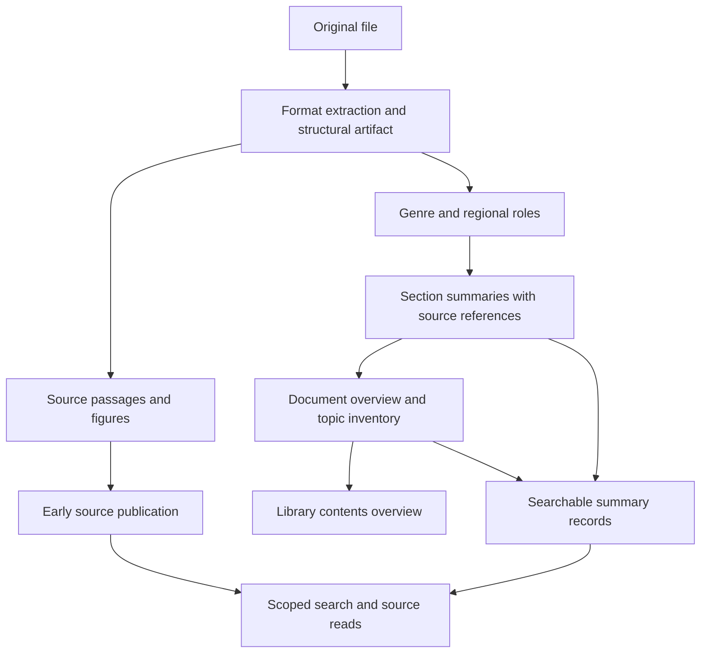

# Structured document understanding and retrieval: implementation proposal

2026-10-28. **Status: proposed architecture; isolated prototype work has begun.** The first structural model and experiment driver are under local development. Three isolated Cosmos indexes have been deployed and passed the existing real-text canary (1,500 passages per index; mean vector recall@10 of 0.985 against exact search). This validates their basic index configuration, not a preference between storage layouts or an improvement in agent answers. Application ingestion/retrieval integration and backfill have not occurred. See the [research assessment](2026-10-28-document-understanding-research.md) for primary sources and the distinction between external evidence and our recommendations.

## Product objective and roadmap relationship

An uploaded file should acquire a reusable representation of what it is, how its contents are organized, what its meaningful parts do, and where the original evidence lives. Agents and people should be able to navigate from library to document to chapter/section to source passage or figure, and enter at any useful level.

This is a broader workstream than adding section-summary vectors and document descriptions independently. It incorporates those two roadmap outcomes and adds genre interpretation, functional roles, relationships, dependency-aware updates and a live library overview. The compact REST work remains its integration foundation. Phase 4 scale proof and Phase 5 hosting/authentication remain separate obligations.

The service prepares reusable representations and returns scoped candidates/evidence. The consuming agent decides what to analyze, compares sources and composes the answer. This follows the existing [library/agent boundary](2026-10-27-library-agent-scope.md).

## What the current implementation provides

| Area | Inspected implementation | Required extension |
|---|---|---|
| Extraction | `extraction.py`: `Section(heading, text, location)`; native format parsers | Preserve hierarchy, source blocks/ranges and relationships through a versioned structural artifact |
| PDF layout | `figures.py:text_sections` splits at headings and page changes; `extract_pdf_figures` caches flattened sections and visuals | Retain layout element/section references, normalize batch coordinates and stitch sections across batches |
| Chunking | `chunking.py` is section-aware, approximately 500 tokens with overlap; emails have special handling | Map chunks to source nodes; initially reuse boundaries where mapping is sound |
| File finding | `api/reading.py:discover` groups passage hits from a bounded candidate window | Add document-summary candidates, merged with passage-derived candidates |
| Source reads | `reading.py` supports full, outline and selected reads over stored extraction | Add logical-node selection, subtree expansion, typed outlines and summary reads |
| References | `evidence.py` binds positional handles to generation, content revision and extraction digest | Add node handles bound to structural revision; preserve legacy handles |
| Publication | `generation.py:is_visible` uses active generation and `publishedChunkCount`; images publish later | Separate summary-set visibility from passage ordinal counts |
| Compact REST | `presentation.py`, `fli.compact.v1`, exact evidence budgets and separate attachments | Explicit summary provenance and candidate types; compatible opt-in extensions |
| Descriptions | `proposals.py`, worker `propose_description`: opening-text hints and sampled library proposals | Whole-document coverage summaries and revision-aware library overviews |
| Operations | Blob checkpoints, queue retries, conditional document publication, ingestion/retrieval metrics | Summary checkpoints, dependency manifests, queue reconciliation and new stage metrics |

Two concrete hazards need fixing before writing summary rows. `is_visible` currently treats a missing `chunkIndex` as -1, which can pass the published-count check. Complete-document fallback queries also select all generation records. Separately, the compact projector labels any non-image `text` as `extracted_source_text`. Simply inserting summaries would therefore risk both source contamination and false provenance.

## Proposed representation

Separate physical format, document genre and regional role. A PDF is a format; a research paper is a genre; methods is a role. A chapter or scene is a structural node. A page is a source coordinate. None needs to be inferred from another unconditionally.

Use a common node representation with optional roles. Allow arbitrary meaningful depth, multiple genre labels and an unknown/mixed fallback. Preserve explicit source structure first; inferred relationships carry evidence references and an observed/inferred/unresolved status. Model confidence scores alone are not calibrated probabilities.

Illustrative fields, not a finalized API schema:

```json
{
  "nodeId": "section-7",
  "kind": "section",
  "parentId": "chapter-2",
  "title": "Results",
  "roles": [{"name": "reported_results", "basis": "inferred"}],
  "sourceRanges": [{"blockId": "block-41", "start": 0, "end": 620}],
  "relatedNodeIds": ["figure-4"],
  "summary": {
    "text": "Generated overview of this region.",
    "coverage": "complete_extracted_text",
    "visualCoverage": "partial",
    "dependencyDigest": "content-and-method-digest"
  }
}
```

Generation, structure revision, source digest, extractor/model/prompt versions and dependency manifests are stored with the artifact/summary set. Coverage describes the available extracted content, never a guarantee that extraction captured every part of the original file. A node's identity is stable within its structural revision; cross-version identity is an optional mapping, not a promise based on equal headings.

Containment forms a navigable tree. Typed links represent captions, references, quotations, attachments and related regions without forcing those relationships into the tree. A figure physically in one section can be discussed in another. Keep both relationships with their provenance.

### Format adapters and genre profiles

| Adapter/profile | First useful behavior | Quality boundary |
|---|---|---|
| PDF | Use layout elements, spans, heading relationships, tables and figures; reconcile bounded batches | Repeated headers, columns and batch boundaries can produce ambiguous ancestry |
| DOCX / HTML / Markdown | Preserve native heading depth and block order; retain Office image extraction | Native styles/headings may be missing or misused |
| PPTX | Slide and element structure, titles, available section grouping and image membership | Do not invent chapter structure from slide order |
| XLSX / CSV | Sheets, tables, headers and row ranges | Narrative summaries do not replace structured data for calculation |
| EML / correspondence | Header metadata, message body, quoted history, signature and enclosure references | Thread reconstruction and attachment ingestion need explicit support; current EML extraction flattens body text |
| Research paper | Methods/results/discussion/limitations and reference regions | Identify roles and summarize stated content; no automatic validity judgment |
| Court opinion | Identify separate opinions, procedural regions, reasoning and disposition when supported | Ambiguous roles stay inferred/unknown; source reads remain available |
| Play | Acts/scenes, speakers, stage directions and dialogue regions | Distinguish source structure from inferred dramatic interpretation |
| General report/manual | Parts, chapters, sections, procedures, appendices and figures | Universal fallback for uncertain or mixed genre |

Start with general reports and research papers, adding a complete correspondence example in the first core release. Follow with plays and court opinions to test that the abstraction generalizes. Existing formats retain their current baseline behavior while enriched support is introduced. New genre interpretations can be corrected without rerunning OCR; corrections invalidate affected derived summaries.

Native extraction and Document Intelligence remain the starting adapters. A small comparison against Docling/GROBID or Content Understanding can justify a specialized adapter. Preserve original Office visual behavior when evaluating replacements; changing parser vendors is not a prerequisite.

### Reuse Microsoft capabilities before extending custom ingestion

Preview status is acceptable for this reference prototype. The next integration decision is reuse-first: evaluate [Document Indexer](https://learn.microsoft.com/en-us/azure/cosmos-db/gen-ai/document-indexer) as an ingestion route and [Logic Apps KBaaS](https://learn.microsoft.com/en-us/azure/logic-apps/create-knowledge-base-agentic-workflow) as a summary/retrieval baseline. Continue using Document Intelligence for PDF extraction. These choices occupy different stages of the pipeline.

Run a bounded compatibility experiment before building more general-purpose ingestion:

1. Process the same small research report, opinion, play and letter through the Microsoft route. Inspect actual records, partition keys, vector policy, source references, summaries and query outputs. Use an isolated database for service-owned schemas; never point a schema-creating preview at application containers.
2. Test replacement, deletion, retry behavior and link resolution. Check whether section ancestry and figure membership survive parsing and chunking; document missing information explicitly.
3. Determine which outputs can enter our structure/summary contract through a thin adapter. Reuse working acquisition, extraction, orchestration, summarization or retrieval components instead of maintaining equivalents solely for the prototype.
4. Retain custom work only where needed: navigable source structure, incremental library overviews, revision-aware publication, typed source/summary results and the consuming-agent contract. Each is a capability to verify, not an assumed product deficiency.
5. Compare total operating costs, including workflow hosting/actions, model calls, Cosmos writes/searches and source expansion. Report provider limitations alongside measured results. Preview availability is not itself a rejection criterion.

The initial custom lab is an experimental control and portable contract, not a decision to own every ingestion stage. No Document Indexer or KBaaS instance has been deployed or validated by this project yet. The live canaries validate the lab indexes only.

## Ingestion and maintenance



1. Preserve blocks, source locations and structural relationships before flattening or chunking. Checkpoint enough information to rebuild the interpretation without repeating extraction. Namespace PDF batch element IDs and normalize offsets; resolve cross-batch ancestry explicitly.
2. Publish usable source evidence through the existing text-first path. Enrichment runs separately, with queued/processing/ready/partial/failed states. A summary failure must not make a readable document unavailable.
3. Classify from metadata, outline and distributed source samples; refine using section analysis. Group small regions in bounded calls. A short letter needs no artificial chapter summaries or one model call per paragraph.
4. Summarize leaf regions from non-overlapping source text, preserving names, topics, important distinctions and source references. Large regions use bounded intermediate summaries. Higher levels use child summaries plus a topic inventory and targeted source checks where necessary. References prove traceability, not factual accuracy; evaluate faithfulness.
5. Keep a concise user-facing overview and enough structured coverage information for discovery. Embed readable descriptions with title/path/role context. Do not average chunk vectors and expect to recover readable document meaning.
6. Freeze each successful output using a digest of source dependencies, interpretation profile, prompt/model versions and options. Retries reuse completed work. Store summary text independently of its vector.
7. Write a complete summary set before conditionally publishing its manifest pointer on the active document. Retrieval requires the matching source generation, dependency digests and published summary revision. Revalidate on replacement/deletion and reject stale node handles.
8. Track text, visual and interpretation dependencies separately. Later image descriptions should refresh summaries that use them and their ancestors, without forcing unrelated text summaries to regenerate. An older summary can remain usable only where its dependencies are still valid and coverage is explicit.

Summary revision is separate from source content revision. This avoids invalidating source handles solely because wording in a preview changed. Structural changes still require new structural handles. Existing positional `ev1` references keep their existing semantics.

Schedule enrichment so long summary jobs do not monopolize a library's Service Bus session ahead of newly uploaded source text. Use bounded resumable work units and the existing quota governors, with measured limits for summary concurrency, depth and total tokens. Count later enrichment and retries in per-document metrics rather than only timing initial availability.

### Library overview lifecycle

Keep `description` as the owner-controlled purpose/scope. Add a generated contents overview with corpus revision, summarized/total document counts, coverage, generation time and freshness state. Offer owner-description proposals separately.

Additions, replacements, deletions and relevant metadata/interpretation changes invalidate the overview. Coalesce a burst of uploads into one rebuild. Use a versioned manifest of document-summary dependencies, not document count alone. Publication must verify that dependencies still match; idempotent events plus reconciliation recover missed/duplicated queue work. A revision increment in a different container alone does not create a transaction over all documents.

For small libraries, regenerate from current document summaries. At larger scale, maintain bounded groups with explicit membership and recompute affected group summaries and ancestors. Initially use stable grouping rather than automatic global reclustering. Retain a topic inventory so rare subjects are not continually erased by prose compression; periodically rebuild from retained summaries to limit accumulated drift.

After a deletion/replacement, an old generated overview must not be exposed as current. Suppress it when its dependency state cannot be validated, while keeping the owner's description. Define and measure the allowed refresh delay; the known Session-consistency issue across API instances remains a production concern.

Tool descriptions can otherwise become stale in consuming platforms. Expose an overview/capability revision and refresh guidance, and return current overview status through discovery. Keep tool descriptions bounded; do not attach the whole library tree to every prompt.

## Cosmos storage and query plan

**Recommended next decision: compare shared and separate summary storage before selecting the application layout.** Retain the current vector policy in both experimental variants. Store the complete structural artifact, ordered blocks and large dependency manifests in Blob. Keep compact published pointers, profile and overview metadata in `documents`; the owner description and contents overview belong in `libraries`.

In the shared variant, store source passages and searchable section/document summaries in one experimental index, with explicit `recordKind`, `nodeId`, `parentNodeId`, structural/summary revisions and source dependencies. Reuse `/embedding`, 3,072 dimensions, float16 and the existing model. A searchable copy of a document overview points to the same published summary set as its catalogue preview.

The existing `/libraryId` → `/documentId` partition key already groups a document's representations. Preserve `/libraryId` as vector shard key. Add scalar indexes only for queried properties such as record kind, node parent, roles, genre and summary revision; consider an ancestor-ID array only if subtree-query measurements justify its write/index overhead. Definitions remain in `cosmos/*.json`.

Make passage/image reads explicitly select source record kinds, with a defined legacy mapping for rows without the new discriminator. Keep summary counts separate from `chunkCount`, image counts and `publishedChunkCount`. Use separate deterministic ID namespaces. Audit opening-text reads, neighbor queries, retagging, purges, metrics and legacy complete reads as well as vector queries.

Every search continues to bind exactly one library from the URL, use bounded `TOP`, preserve float16 query conversion and the existing hybrid-routing workaround, and exclude embeddings from projections. Narrow reads use the full document partition key. Parent traversal follows IDs in stored structure; it need not use a graph database or cross-item SQL joins.

In the split variant, use one passage index and one summary index containing all structural levels. Give summary records the same library/document partition keys, vector policy and source links. Avoid a container per genre, level or library. The current experiment uses `lab-shared`, `lab-passages` and `lab-summaries`; the application containers are unchanged. Each experimental index must pass the standard canary before loading structured data.

Freeze source records, generated summaries, embeddings and query vectors once, then reuse them across both layouts. Compare typed passage, section, chapter and document queries at matched corpus sizes and selectivity, including writes, index readiness, RU, latency, ANN recall and source-expansion costs. Separately compare passage-only retrieval with structural retrieval: changing representation and storage layout simultaneously would confound the result. Separate summary storage may offer useful lifecycle and throughput isolation, but adds cross-container coordination and potentially another provisioned-throughput floor. Neither layout is the selected winner yet.

The shared application variant would need scalar-index additions and an audit of every reader that currently assumes a text row is source evidence. The split variant needs an additional index plus coordinated publication and deletion. Neither requires a new embedding space or vector-policy change. If later experiments replace the embedding model, use a separately validated rebuild even for equal-size vectors. Current Microsoft policy-mutation documentation differs from older repository assumptions; see the research memo rather than changing those settings opportunistically.

## Retrieval and compact REST integration

Use typed, bounded candidates. A summary is a discovery representation; a source passage is evidence. Search scores from different representation levels are not automatically comparable.

| Existing capability | Proposed extension |
|---|---|
| File finding | Search document summaries plus passage-derived document candidates; deduplicate and report selection provenance/coverage |
| Passage search | Preserve direct library-wide retrieval; optionally scope to returned structural nodes or explicit regional roles |
| Outline | Return a bounded subtree with node kinds, roles, summaries, children and source-token estimates |
| Selected read | Resolve node handles to exact source regions, including a chapter's descendants; deduplicate overlapping selections |
| Image inspection | Return section membership and related summary context separately from the printed caption and original body text |
| New section finding | Return section/chapter candidates with parent document and source-expansion handles |

For the first version, make section finding an explicit REST capability, tentatively `POST /v1/libraries/{libraryId}/sections:discover`, surfaced as a fifth library tool. Keep the four current tools' purposes stable. Add optional `nodeIds` to selected reads and a bounded node selector to scoped search. Final request names are subject to the contract review in milestone 0.

Run document, section and passage candidate searches with separate budgets, merging at the service layer when requested. Preserve a direct passage route for minority topics omitted by summaries. Whole-corpus enumeration remains a catalogue operation, not a claim made from top-k results. Optional reranking is an independently evaluated retrieval stage.

Contextualizing existing passage embeddings is a separate backfill from adding summary vectors. A vector-only variant can embed generated context plus source while retaining original source text. Reproducing contextual lexical retrieval also needs a distinct indexed search representation and exact original-text storage/projection: today's `/text` serves both purposes. Evaluate that field/full-text-policy change explicitly; never prepend generated prose to a field that readers treat as original evidence. Context changes then invalidate the affected passage embeddings as well as summary vectors.

Keep `evidence`, `attachments` and `metadata`. Put generated summaries in explicitly typed discovery entries with `textSource: generated_summary`, source handles and coverage. Change the projector's current non-image-text assumption before enabling them. Keep URLs and operational details outside model-facing evidence. New fields/operations are opt-in; if existing meanings or accepted enum values must change incompatibly, version the contract rather than silently changing `fli.compact.v1`.

Full and selected source reads retain all-or-nothing budget semantics. A summary does not establish that a chapter was read. A chapter too large to fit returns its extent and available smaller selections; staged reading remains explicit. Outline pagination describes returned nodes, not a complete document read.

## Cost and effort assessment

Illustrative sizing for a 20,000-token text document, ten meaningful sections, 200-token section summaries and a 300-token document overview:

| Incremental work | Approximate amount |
|---|---:|
| Source input to section summaries | 20,000 tokens |
| Child-summary input to document overview | 2,000 tokens |
| Generated section/document text | 2,300 output tokens |
| Summary embedding input | 2,300 tokens, plus contextual fields |
| Searchable summary records | 11 |

This excludes classification, prompts, reasoning, retries, topic inventories, source verification, image analysis and library aggregation. It is a lower-complexity planning example, not measured usage. Compared with roughly 40 source chunks ignoring overlap, it adds about 28% more vectors; embedding text length does not reduce vector dimensions. Do not estimate stored JSON or indexed bytes from float16 dimensions alone; measure actual item and index sizes.

For 1,000 such documents, the basic summary stages use approximately 22 million input and 2.3 million visible output tokens, plus 2.3 million embedding-input tokens. At rates `I`, `O` and `E` dollars per million respective tokens, the calculation is `22I + 2.3O + 2.3E`. For sensitivity only, hypothetical rates of $1 input, $5 output and $0.10 embedding would give $33.73 before the excluded work and infrastructure. These are assumptions, not current provider/deployment prices. Reasoning-token billing must be included in measured output usage.

Reuse extracted text when possible. Fresh PDFs already use layout analysis in our worker, so retaining more of that response need not require an additional layout call. Old checkpoints have discarded relationships, making selective re-extraction a distinct backfill cost. Genre inference or a second parser adds its own cost.

Batch library updates: 100 document summaries at 300 tokens require about 30,000 aggregation-input tokens. Doing that after every file in a bulk import repeats work unnecessarily. Larger libraries need bounded group aggregation. Answering cost may fall through more selective reads or rise through extra tool rounds; report total model usage, latency and RU rather than assuming savings.

Engineering is a cross-cutting feature. A provisional planning allowance is **4–8 engineer-weeks for an evaluated core across the existing stack**, with **another 4–8 for broader genre coverage and rollout hardening**. This assumes an experienced engineer, available corpus review, existing Azure deployments and no replacement of production authentication/hosting. It is judgment from code inspection, not a delivery commitment; revise it after the structural prototype. A narrow end-to-end demonstrator should precede that full investment.

## Delivery sequence and acceptance

| Milestone | Deliverable | Exit evidence |
|---|---|---|
| 0. Contracts and baseline | Versioned structure/summary schema, publication protocol, candidate/source API distinction, labeled corpus | Explicit semantics for legacy files, revisions, budgets and failures; baseline recorded |
| 1. Structural vertical slice | PDF plus one native format; heading ancestry, figure membership, chapter reads | Source extents resolve correctly across pages/batches; overlapping reads deduplicate; ambiguous membership disclosed |
| 2. Reusable summaries | Section/document summaries, coverage/topic inventories, profile hooks, resumable enrichment | Whole-file topic coverage reviewed; retries reuse outputs; text remains available on enrichment failure |
| 3. Search and navigation | Document/section candidates, source expansion, compact REST and demo integration | Held-out document/section/image queries improve without hiding ordinary or minority-topic passages |
| 4. Library maintenance | Owner description plus generated overview, coalesced revision-aware updates | Add/replace/delete and same-count changes produce correct overview state; stale dependencies never presented as current in tested consistency scope |
| 5. Broader interpretation | Correspondence, plays, court opinions, mixed-document regions; selective parser comparisons | Role and relationship accuracy evaluated by family; unknown/ambiguous cases retain useful fallback |
| 6. Rollout and scale | Opt-in backfill, cost estimates, canary, feature flags, mixed-version operation and recovery | Query/write RU, index readiness, p95 latency, backfill cost, deletion/replacement and personal-library isolation verified |

Milestones 1–4 deliver a usable capability; genre hooks begin in milestone 0/2, and milestone 5 expands tested coverage. At milestone 3, evaluate contextualized passage embeddings and reranking as independent variants rather than silently combining all interventions.

The first isolated implementation starts with lossless Markdown heading trees and explicit genre hints to test storage and navigation independently of parser quality. Small synthetic research, opinion, play and correspondence fixtures are functional demonstrations, not relevance benchmarks. The next format milestone should use a multi-chapter PDF and a structured DOCX report. It should find a chapter by subject, read that chapter with its relevant figure references, discover the document through its overview, and update a library overview after adding then deleting another file. That tests the full idea before multiplying formats and profiles.

### Evaluation design

Begin with roughly 40–60 varied documents and 150–250 labeled questions, including held-out documents. Cover reports/papers, correspondence, court opinions, plays, slide decks and tables, with explicit mixed/poorly structured cases. Include original figures and source answers. This is a proposed first evaluation size, not a guarantee of statistical power.

Compare the current baseline with structural navigation only; then summary candidates; then genre/role enrichment; then contextual embeddings and optional reranking. Keep answering model, questions, source versions and budgets fixed. Repeat nondeterministic runs and report uncertainty by task family.

Measure document/section/passage and image recall separately, region-boundary correctness, wrong-parent association, role accuracy, summary faithfulness and omitted topics, answer/citation quality, tool rounds, cumulative tokens, ingestion and query latency, RU and storage. Include exact vector references for approximate-index recall, separately from human relevance judgments. Search a minor topic deliberately omitted from a summary.

Mechanism tests must cover retry/concurrency, summary failure, stale source/summary handles, replacement with unchanged document count, deletion, user role corrections, partial visual coverage, exact budgets, legacy fallback and library isolation. Preserve existing malformed-source and image-caption cases. Freeze rollout thresholds after the baseline; do not claim a universal percentage improvement in advance.

### Migration and rollout

Deploy compatible readers and explicit source-kind filters before enabling summary writers. Add scalar indexes and verify readiness. Enrich new uploads behind feature flags; evaluate in a small authorized canary, then opt in existing files with per-file work/cost estimates.

For old files, distinguish summary-only enrichment from hierarchy recovery. Existing extracted text supports bounded summaries with declared structure limitations. Recover native structure from originals where possible. PDFs may need layout reruns because current checkpoints omit the original relationship graph. Legacy chunk-only files retain overlap and completeness limitations. No automatic bulk reprocessing follows from this proposal.

Rollback disables summary retrieval/publication and restores the source-only path without destroying originals or existing embeddings. Purges must remove all artifact/summary revisions and source copies according to the same lifecycle policy. Reconciliation finds incomplete publication and stale library dependencies. Validate behavior across independent Cosmos clients before claiming immediate cross-instance freshness.

## Recommended next implementation decision

Treat this as a named workstream, **Structured document understanding and retrieval**, with milestones 0–4 as the core scope and broader genre interpretation as an intentional expansion. Build the first structural vertical slice on the current Azure/Cosmos stack. Use parser replacements, global thematic graphs and alternative embeddings as evaluated extensions when the baseline exposes a specific need.
