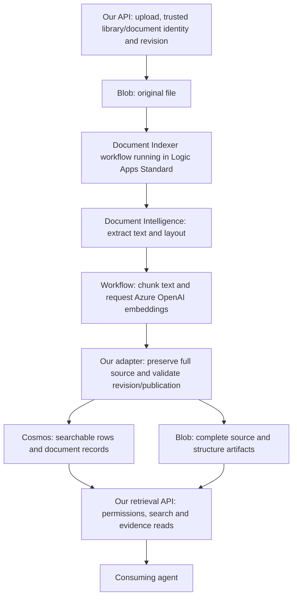

# Should we use Microsoft Document Indexer?

Completed 2026-10-29. This continues the [extraction comparison](2026-10-28-microsoft-reuse-compatibility.md),
[research](2026-10-28-document-understanding-research.md) and
[proposal](2026-10-28-document-understanding-proposal.md). The normal application,
demo and default deployment are unchanged. The [aggregate record](../../records/indexer-workflow-20261028.json)
contains sanitized measurements; the [runbook](../indexer-workflow-lab.md) describes
the opt-in infrastructure, package builder, publication helper and tests.

## Recommendation and purpose

**Use a customized Document Indexer workflow as the preferred candidate for moving
text-ingestion orchestration out of our Python worker. Do not replace the current
worker in the normal application yet.** The experiment demonstrated that this route
can feed our existing retrieval API while retaining Microsoft extraction, chunking
and embedding. It did not demonstrate feature parity or lower total operating cost.
The recommendation is to integrate and evaluate this candidate behind the existing
contract, not declare migration complete.

The larger objective is a file library in which agents can find files, navigate
their meaningful sections, read complete source evidence and retrieve figures,
with correct permissions and revision/deletion behavior. The decision tested here
was whether Microsoft's ingestion offering could supply enough of that foundation
to avoid expanding our custom ingestion engine. A successful Cosmos write is only
one prerequisite; it is not the product objective or the adoption criterion.

| Adoption question | Recommendation |
|---|---|
| Use Document Indexer unchanged? | **No.** The tested template failed our hierarchical-key writes and lacked the required source/publication lifecycle |
| Use Document Indexer with application-specific adaptation? | **Yes, as the preferred next integration candidate.** The deployed experiment established a working text path and sequential lifecycle/API compatibility |
| Replace all current ingestion now? | **No.** Preserve the working path until visual/native-format parity, scheduling/race behavior and operating cost are evaluated |
| Does it deliver the planned document-understanding layer? | **Partly.** Layout structure can be retained, but complete authored chapters, summary hierarchy and library overviews still need work |

## Where Document Indexer fits

Microsoft describes [Document Indexer](https://learn.microsoft.com/en-us/azure/cosmos-db/gen-ai/document-indexer)
as an integration with Logic Apps Standard templates running in the customer's
Azure resources. A **template** is the supplied starting workflow definition;
deploying it creates an executable workflow. Logic Apps is its runtime, Document
Intelligence performs extraction, Azure OpenAI supplies embeddings, and Cosmos DB
stores/searches the resulting records. Customizing the workflow is part of this
model. We deployed the pinned definition directly rather than testing the portal
wizard; the findings apply to that Blob/OCR variant, not all template choices.

This is the **tested candidate architecture**, not the normal demo's deployed
architecture. Document Indexer would take over the text acquisition→extraction→
chunking→embedding→row-writing portion currently orchestrated by our Python
ingestion worker. Our API, authorization, revision/publication policy, source
reading and deletion responsibilities remain. Native Office visuals and the
working direct DI figure path also remain until parity is proven. KBaaS is a
separate candidate ingestion/retrieval offering; it was not inserted between these
components and was not run in this experiment.

## What was compared

There were two comparisons: an **architectural compatibility comparison** against
our current application contract, and **live controlled comparisons** between
the Microsoft baseline and adapted workflows. We did not run the current Python
worker and Document Indexer side by side on a matched quality/cost benchmark.

| Route | Basis of comparison | What we learned |
|---|---|---|
| Current Python worker | Existing implementation, documented capabilities and prior tests; not rerun as a matched benchmark | It is the working baseline for API lifecycle, native formats, complete reads and images; migration must preserve those behaviors |
| Stock Document Indexer Blob/OCR workflow | Deployed six-document run | Microsoft processing reached embeddings, but the final write failed; its projection also discarded extraction structure |
| Indexer with a minimal Microsoft writer bridge | Deployed add/replay/replace/input-delete controls | Fixed transport compatibility while exposing the stock GUID and lifecycle limitations |
| Indexer with layout/source/publication adaptation | Deployed extraction plus existing API against real isolated stores | Demonstrated complete provider-text reads, preserved layout artifacts and sequential lifecycle/isolation; visual and logical-section gaps remained |
| Direct DI read versus layout | Earlier six-document extraction comparison | Established what the extractor can supply independently of what Indexer preserves |
| KBaaS | Documentation/contract inspection only | External source-evidence retrieval is still unverified; no runtime comparison was made |

The experiment therefore supports **feasibility of reusing Document Indexer with
a bounded adapter**. It does not establish that switching is cheaper, faster,
more accurate or operationally simpler than retaining our worker. Those are still
adoption questions, including the cost of operating both paths during migration.

## What the adaptation means

Retain the Indexer workflow's Blob acquisition, Document Intelligence, token
chunking and embedding stages. Use Microsoft's built-in Cosmos connector for its
write stage. Keep a small application-owned boundary for trusted library/document
identities, immutable source checkpoints, deterministic row IDs and conditional
publication through the existing document contract. The deployed adapter
establishes this boundary for complete provider text; it is not a production
ingestion replacement or a new chapter-reading API.

Do not adopt the pinned template unchanged: its managed Cosmos writer failed
against our hierarchical partition key. After bridging that writer, its default
GUID/lifecycle behavior duplicated rows on replay, retained old replacement text,
and did not remove rows when input blobs disappeared. These are measured failures,
not reasons to replace the working Microsoft extraction/chunking/embedding stages.

Keep native Office image extraction and the existing direct Document Intelligence
figure-download path. Resolve authored chapter boundaries and durable figure
copies before promising complete logical-section or visual retrieval. Defer KBaaS
as this API's retrieval backend until an externally usable source-evidence contract
is demonstrated. No custom general ingestion engine is justified by these results.

## Readiness and isolation

Effective permissions, provider registrations and quota were rechecked before
provisioning. A region listing alone was insufficient: the first WS1 deployment
encountered a zero quota. Actual regional Web usage/quota checks identified a
location with limit 30 and usage zero; one WS1 host was then provisioned there.
Web and Logic providers were registered. No additional model was deployed.

The dedicated group held the host, plan, identities, key-disabled storage,
Document Intelligence account and connections. A **new isolated database** in an
existing Cosmos account held libraries, documents and indexer-lab; no application
container was modified. All new containers passed the standard canary: 1,500 real
passages, index engagement after 307 seconds, mean recall@10 0.985 over 20 queries.
These are canary results, not an evaluation of the six small structural fixtures.

Cloud service connections used managed identities. A separate user-assigned
identity supplied host storage and private package access; the workflow system
identity supplied connectors. Shared-key storage access and Document Intelligence
local authentication were disabled. A successful smoke run verified the keyless
host rather than merely accepting its configuration. Operator calls used Entra.

## Actual workflow and emitted schema

The source is Microsoft's [pinned Blob/OCR template](https://github.com/Azure/LogicAppsTemplates/blob/e6b7d87e120a400b3e321caacf858c08fa4d060f/ingest-doc-blob-document-intelligence-cosmos/default/workflow.json).
Commit and byte hash are checked by the builder and recorded with the measurements.
Mounted workflow JSON was compared with the expected package. The baseline's only
changes were parameter substitution and secure run-history settings.

| Variant | Observed behavior |
|---|---|
| Pinned processing baseline | All six read/analyze/chunk/embed paths succeeded; all managed writes failed; zero rows |
| Properly mapped item with original managed writer | Still failed HTTP 400 partition-key mismatch; error reported Microsoft.Azure.Documents.Common/2.14.0 |
| Built-in write bridge | CreateOrUpdateDocument succeeded using `accountURI`, managed identity, item-derived hierarchical key and upsert |
| Layout/checkpoint adapter | Seven initial files across two libraries succeeded; full layout artifacts and exact original bytes retained |

The built-in connector's scalar `partitionKey` parameter cannot be supplied as a
JSON-stringified array to represent our hierarchy: that override failed 400/1001.
Omitting it allowed the modern SDK to infer both key components from the item.
This is evidence for the tested connector/runtime, not a universal connector guarantee.

The upstream projection contains chunk text/vector, documentName, fileType,
chunkNumber, totalChunks and random `id`. Live chunkNumber/totalChunks were strings,
not integers. It sends only `analyzeResult.content` to 5,000-token/200-overlap
cl100k_base chunking and discards structure. The write bridge adds trusted
libraryId/documentId, generation, integer chunkIndex and text provenance while
preserving the original read/chunk/embed behavior and GUIDs for the control.

The layout variant uses prebuilt-layout with Unicode code-point offsets. Before
chunking, it freezes the full managed analysis body/output plus exact original
source bytes and name. Its deterministic IDs are document:generation:ordinal.
The full extraction graph stays in a sidecar; complete reads use every character
of provider content as one canonical source section, **not reconstructed chunks**.

## Capability and gap assessment

The corpus comprises a nested PDF with a figure, DOCX with an embedded image,
scan, paper, play and opinion. A duplicate document ID in a second personal library
tests scope independently of document identity. Fixtures are small and mostly
synthetic structural probes; no general relevance, genre or answer-quality claim follows.

| Capability | Evidence and remaining gap |
|---|---|
| Source acquisition/OCR/chunk/embed | Microsoft components completed all six cases; retain them |
| Full structure preservation | Layout artifacts retained sections, paragraphs, element links, spans and figure metadata; original bytes matched in all seven uploads |
| Logical chapters | Nested report had nine sections and valid links, but its chapter-one subtree omitted the limitations section; chapter-two, Act II and dissent probes passed. Graph preservation does not repair inferred authorship |
| Complete source reads | Seven exact matches to full provider content through the existing API; budget failures returned no partial sections |
| PDF images/captions | One figure and its caption/regions survived. Zero figure crops were copied. Managed analysis output supplied no Operation-Location/result handle for downloading them; the earlier direct DI route did demonstrate figure download |
| Office visuals | Known native embedded image was omitted by DI; retain the existing native path and disclose the omission |
| Retry | Bridged default grew six rows to seven with six unique texts. Adapted replay succeeded with unchanged IDs/checkpoint and skipped DI analysis; embeddings were still recomputed |
| Replacement | Bridged default grew to eight rows and retained old/new text. Adapter staged revision two while old source stayed readable, then conditionally published the new revision; stale generation and prior-revision section reference returned 409 |
| Immutable source | Overwriting an existing revision was rejected as source_revision_changed; published generation, source digest and checkpoint stayed unchanged |
| Deletion | Bridged default removed zero rows during a 90-second input-delete observation. Existing API deletion hid the adapted document before purge, then the existing worker removed its rows/artifacts |
| Isolation | Wrong agent received 403 on tools/search/discover/read/images in both personal libraries; absent cross-library document returned 404; same-ID document in the other library survived deletion |
| Inventory/overview | Existing worker refreshed counts 6→6→5 and preserved owner description. Generated library overview and section/document summary hierarchy were not implemented |
| KBaaS | External identifiable source evidence remains unverified; no dataset, agent loop or new agent model was provisioned |

API checks used the existing FastAPI application via ASGI transport with **real
isolated Azure Cosmos/Blob stores and real query embeddings**. They did not deploy
a new public API or establish production Entra integration. Publication and
inventory refresh were explicitly driven by the lab. Lifecycle probes were
sequential; concurrent publishers, late writers after deletion and cross-instance
immediate freshness remain existing production-hardening questions. The stale
section reference was derived from the frozen prior revision, rather than captured
as an earlier API response. Cached replay was verified in the first scope; the
second scope tested initial ingestion and isolation, not replay. The final public
builder reproduces the mounted definition used by the successful replay test.

## Concrete integration boundary

1. Keep the existing API, permission checks, full-source reader and deletion worker.
   Have trusted application code allocate library/document IDs and monotonic
   revisions; never obtain library scope from agent arguments or untrusted filenames.
2. Use the Microsoft workflow stages proven here, the built-in Cosmos writer and
   immutable full-layout checkpoint. Treat a same-revision byte change as an error.
3. Validate scope, source binding, deterministic IDs and the complete ordinal set
   before a conditional active-generation publication. Wire this boundary into the
   existing scheduling/retry/deletion lifecycle before any rollout. The opt-in
   helper demonstrates publication, not a continuously operating service.
4. Preserve the layout sidecar and native source/visual paths. Add a supported
   figure-result handle/copy step and authored-section validation before exposing
   the planned structural API. Keep the frozen-artifact harness as the control.
5. Evaluate representative real documents and agent tasks after those gaps close.
   Do not infer summary recall, scale superiority or lower operating cost here.

For KBaaS, the earlier [documented contract check](2026-10-28-microsoft-reuse-compatibility.md#kbaas-external-retrieval-gate)
remains the gate: an agent-loop answer or management CRUD operation does not prove
externally resolvable source evidence. The next KBaaS action is to obtain and test
that supported operation/bridge, not query its private storage schema.

## Validation, costs and cleanup

The full suite passed **697 tests**, with 14 existing TestClient warnings. Lint,
format, Bicep compilation, diff and identifier-deny checks passed. Tests cover
unchanged baseline processing, connector parameter/auth constraints, cached JSON
decoding, checkpoint/revision guards, complete row sets, exact Unicode source,
conditional publication and deletion non-resurrection.

The record includes measured canary load RU, embedding usage and timing. It does
not contain an invoiced full-workflow cost: WS1 hosting, connector actions, OCR,
embeddings and storage must all enter any operating-cost comparison. Small fixtures
and canary timings cannot establish a cost or performance winner.

Cleanup was confirmed: dedicated resource group absent, isolated database absent,
and zero remaining experiment Cosmos/Azure OpenAI role assignments outside that
group. Provider registrations remain; no lab host or model deployment remains.
All environment identifiers, raw runtime outputs, source snapshots and packages
were kept outside the repository. Sanitized aggregate records are durable evidence;
private temporary files are not a reproducibility dependency.
