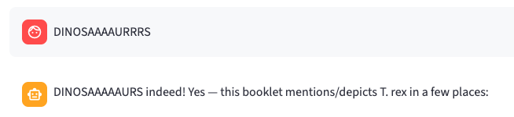

# Finding, reading and showing images



Image content participates in the same semantic retrieval path as text. During ingestion the worker asks the vision deployment to describe each kept image: what it depicts, visible text and numbers, chart axes and legends, comparisons and trends. The filename, heading or slide title, location, and up to 2,000 characters of nearby source text accompany the description. That text is embedded with the library's normal text embedding model. A vague request such as “I remember a chart showing GDP growth over time” can therefore retrieve the chart without the user knowing its filename or caption.

Search results retain `documentId` and `generation`, so an agent can read the complete parent file for its explanation, then search for additional supporting passages in either direction. The library supplies evidence and tool descriptions; the consuming agent decides how much evidence to retrieve and how to compose its answer.

## Supported inputs

| Input | Returned visual and provenance |
|---|---|
| PNG, JPEG, GIF, WebP, TIFF, BMP | Normalized PNG, first frame/page, EXIF orientation applied; `kind: standalone_image` |
| DOCX | Embedded pictures in body paragraphs and tables; nearest heading, paragraph number, nearby paragraphs; `kind: embedded_image` |
| PPTX | Picture shapes, including pictures inside groups; slide number/title and slide text; `kind: embedded_image` |
| PDF | Document Intelligence layout-defined figure crops, including raster illustrations and vector charts; page/figure identity, bounding regions and linked source captions; `kind: pdf_figure` |

For PDFs, `prebuilt-layout` with `output=figures` separates page text, tables, figures and captions. The worker downloads the service's cropped figure PNGs; it never promotes a PDF page, raster object or drawing primitive into an image. This also works for scanned pages: their page-sized raster is an input for layout analysis, not an image candidate. There is no whole-page fallback when layout fails. Existing `kind: pdf_page` generations remain readable until explicitly reprocessed.

Body paragraphs and reconstructed table rows form ordinary text sections. Graphic-internal labels stay with the figure description. Captions remain in the body text **and** accompany their figure as attributed source text, with `caption` and `captionLocation` in the image metadata. This lets a caption-only question retrieve ordinary passages, and a vague visual question retrieve the figure with its original caption. Generated descriptions and source captions are labelled separately. PDF crops exclude the caption when the service locates it separately; the caption travels alongside the pixels. DOCX pictures use adjacent Caption-style or figure-labelled paragraphs; PPTX pictures use nearby figure-labelled text in the same coordinate space. Other nearby text is context, not an attributed caption.

Size rules skip pictures below `IMAGE_MIN_PIXELS` (16,384) or `IMAGE_MIN_BYTES` (default 0, disabled), and describe/index at most `IMAGE_MAX_PER_DOCUMENT` (50) per file; source image/caption assets are stored separately as described below. Compressed size is a poor indicator of importance: a readable 640×400 chart can be smaller than 5 KB. Small/unsupported pictures and figures beyond the cap contribute to `imagesSkipped`. PDF source figures are stored up to the separate source-asset limit; only the first description-cap figures are described; subsequent pages still receive text extraction. Kept images become PNGs at most 4,096 pixels on their longest side. Inputs above 40 million pixels are skipped before pixel decoding. Multi-frame uploads use their first frame only.

Layout is a learned segmentation service, so figure boundaries or caption associations can still be wrong. Native Office chart objects, SmartArt, linked images, headers/footers and unsupported vector media such as EMF are outside native picture extraction; exporting to PDF enables layout-based figure extraction. The library discloses skipped candidates rather than promising every visual was captured. Descriptions can misread labels or values; inspect the pixels when precision matters.

## Retrieval contract for consuming platforms

The library-bound `/tool` and `/tools` definitions explain image search when the library has images. Search text and images together by default, or use `filters.contentKinds: ["image"]` to narrow to visual evidence. A returned image passage includes:

```json
{
  "chunkId": "<document-id>:1:4",
  "imageId": "<document-id>:1:4",
  "documentId": "<document-id>",
  "generation": 1,
  "fileName": "Economic-outlook.pdf",
  "location": {"page": 3, "figure": "3.1"},
  "heading": "Economic outlook",
  "contentKind": "image",
  "text": "Image from Economic-outlook.pdf, page 3: … Nearby source text: …",
  "image": {
    "url": "https://<storage>/<container>/<image>?<read-only-delegation-SAS>",
    "expiresAt": "<UTC timestamp>",
    "width": 1200,
    "height": 800,
    "mime": "image/png",
    "kind": "pdf_figure",
    "caption": "Figure 1: GDP growth over time",
    "captionStatus": "identified",
    "captionAssociation": "layout",
    "captionLocation": [{"pageNumber": 3, "polygon": [1, 6, 7, 6, 7, 6.5, 1, 6.5]}],
    "regions": [{"pageNumber": 3, "polygon": [1, 2, 7, 2, 7, 6, 1, 6],
                 "unit": "inch", "pageWidth": 8.5, "pageHeight": 11}]
  }
}
```

Complete-document reads include every published indexed image as a section with the same `imageId`, its description, heading, location and a newly issued `image` link. Text sections remain intact. New enriched snapshots place image sections after the last text section at or before their page (PDF), slide (PPTX) or paragraph (DOCX), preserving source order on ties. Chunk IDs/indexes and the text-only snapshot are unchanged. Existing frozen generations retain their order; reprocessing produces the new order. Legacy `indexed_chunks` reads stay in chunk order. The response still obeys the all-or-nothing text budget. The catalogue and full-read manifests expose `imageCount`/`imagesSkipped` for semantic coverage and `sourceImageCount`/`sourceImagesSkipped` for stored source coverage; raw Blob references never enter agent retrieval responses. The text token estimate includes serialized descriptions and links, but **does not include the model's visual-input tokens**.

A consuming platform should:

1. Bind tools to the attached library and supply the agent identity as it does for text retrieval.
2. Preserve image IDs and source locations in tool results. Let the agent search, read parent documents and mix supporting evidence as needed.
3. Fetch image URLs before their `expiresAt` to display them. These are HTTPS, read-only, blob-scoped user-delegation SAS links valid for 15 minutes. Treat them as bearer capabilities, never log them or embed them in durable public content. Re-retrieve evidence for a fresh link when needed. Already issued capabilities remain usable until expiry even if a document is replaced or deleted.
4. If its model accepts images, supply the actual pixels/URL as a native image content part; a URL inside JSON alone does not make a model see an image. Text-only agents can use descriptions and still return the image for the platform to display.
5. Place a chosen image at the relevant point in the answer when it helps explain the subject, even without an explicit picture request. Include its stored source caption by default and allow the agent to omit it when appropriate, retaining source provenance. Reuse evidence already returned; do not fetch the same figure again merely to obtain its caption. Cache any fetched bytes within the platform's authorized conversation scope, rather than depending on an expiring link for durable chat history.
6. Budget image tokens according to the answering model, in addition to text, history and answer space. If pixels were withheld, do not claim visual inspection.

The prototype demonstrates this contract with `` answer references, resolved only against images returned by tools. This marker is a demo convention, not an API requirement. Streamlit displays the image inline and keeps a bounded, session-local image cache. A sidebar control supports text-only models; image descriptions and display continue working. The agent loop supplies native image content parts after all tool replies in the round, deduplicates image IDs, and accounts from the last provider-reported prompt usage plus estimated additions. New or unreported images reserve `DEMO_IMAGE_TOKENS` (default 8,192) per visual; room for the answer remains reserved. Platforms using different models must apply their own image accounting.

The demo projects search, complete-read and page-image tool results before sending text to the model. It retains image IDs, kind, captions/association, source provenance, completeness, estimates and coverage notes; signed URLs, expiry, geometry/dimensions and telemetry stay with the platform. Native image parts and display resolve attachments independently of that text. Full-read section text is never clipped. Raw REST responses and their conservative token estimates remain unchanged. This is an adapter convention; a proposed `view=agent` REST envelope is deferred for platform-contract review.

## Selecting a figure and returning its stored caption

Image pixels and source-caption metadata are paired during ingestion, before publication. The immutable generation manifest at `text/{generation}/image-assets.json` stores each source figure reference, caption text or an explicit absence, association/location and stable image ID. The worker stores captions alongside indexed image descriptions before embedding, so caption meaning participates in semantic retrieval. Ordinary page text also retains the caption. No answering-time caption extraction, recovery call or caption-driven answer rewrite is performed.

The 50-image `IMAGE_MAX_PER_DOCUMENT` limit bounds AI descriptions/semantic indexing. Source assets have a separate `IMAGE_ASSET_MAX_PER_DOCUMENT` limit (default 1,000, maximum 10,000). Qualifying source figures and captions beyond the description cap are still stored. Direct access supports selected image IDs across supported formats and PDF page reads. Selected source-region reads expose retained Office image candidates, including unindexed pictures, without reprocessing valid manifests. Size/format and asset-count omissions are explicit, including which PDF pages were affected. PDF preparation retains metadata rather than loading all stored PNGs into worker memory; native pictures are normalized/uploaded one at a time. Enrichment bounds loaded crops per document by `VISION_CONCURRENCY` (default 2), describes them concurrently under the worker-wide HTTP governor, and reuses their references without a second upload. Failure cancels sibling tasks; publication and output indexes remain all-or-nothing and in source order. This can shorten a single file's enrichment but does not increase aggregate HTTP quota. PDF normalization runs off the async event loop. Text and the source-asset manifest can publish before slower descriptions finish.

Semantic search returns ranked **candidates**, not a declaration that every hit answers the question. Platforms select matching figures before displaying them. The demo shows only explicit `fli-image` selections inline; unselected candidates are diagnostic text rather than a gallery of asserted matches. A search image is previewed automatically only when it leads the overall result ranking, leaving context for targeted source reads.

`heading` is contextual section text, never a figure title. `image.caption` is the associated source caption and `captionStatus` says `identified` or `not_identified`. `captionAssociation: layout` records a layout-service link. A conservative fallback during ingestion accepts close, aligned labelled/attributed text, excludes headings/body prose/ambiguous associations, and records `adjacent_inferred`. That is exact source text with an inferred attachment; the UI labels the uncertainty. Internal extraction IDs are not printed figure numbers.

The agent receives the image and caption together. The demo displays the caption by default, with provenance. For situations where displaying it is unnecessary, the agent can use ``; this omits caption text while retaining the file/page citation. The caption remains available in tool evidence for the agent's reasoning.

For a known PDF page, use `inspect_images_library_<name>` or:

```http
POST /v1/libraries/{libraryId}/documents:images
X-Agent-Id: <bound-agent-id>
Content-Type: application/json

{"documentId":"<id-from-search>","generation":1,"pages":[94]}
```

This is a read of stored assets and extracted page text: 1–3 distinct pages, at most 10 returned figures, with explicit omissions. `scope: stored_pdf_page_images` distinguishes it from a whole-file read. It works beyond the semantic-description cap without layout, vision, embedding or storage-write work at retrieval. It validates the manifest digest and active source generation and rechecks lifecycle/permissions after issuing image links. Older files without the manifest explicitly require reprocessing rather than reconstructing captions during the question. No Cosmos container/index change is required.

## Mixed text and image answers

A single semantic search can return ordinary passages and image descriptions. The agent can explain a finding from text, insert a supporting image/caption at the appropriate point, and continue its answer. Returning a text passage does not automatically attach neighboring pictures; the image must itself rank, arrive through a complete read, or be selected through a stored PDF page read. Descriptions and captions are sufficient for a text-only agent to choose and display an image; visual inspection requires actual image inputs.

The service does not require a special “find pictures” question, another search for the caption, or a second answer-generation pass. Library tool descriptions explain this contract. For a remembered figure tied to a passage, match the passage's document/page rather than substituting a same-subject image elsewhere. The demo renders the caption from returned metadata, so it need not be repeated verbatim in the answer prose. The choice to include a figure remains the consuming agent's; current smoke checks establish that the mechanism works, not that every model will choose the best illustration for every question.

## Efficiency and current limits

- Captions remain searchable both as page text and as attributed image text. This intentional duplication supports both entry points without an additional caption model call or vector index.
- Cosmos retains descriptions, vectors, locations and publication pointers. Blob retains immutable pixels, source manifests and checkpoints. Each search still scopes to exactly one library; there are no cross-library joins or new containers/policies.
- Layout batches and successful image descriptions survive retries. Text embeddings survive image enrichment. Conditional publication and lifecycle checks are retained even where they add reads; dropping them would risk stale or inconsistent evidence.
- Source extraction and layout still precede text publication. Layout currently resubmits source bytes per batch, and page-image reads load the stored text/asset manifests before selecting pages. These are bounded prototype costs, not a claim of minimal possible latency.
- Search previews automatically supply an image only when it leads the overall result ranking. A top-ranked text hit does not promote a lower-ranked image into a native preview. Further visual selection and token budgeting belong to the platform. Model work, image tokens and tool rounds can dominate total answer time; a small Cosmos retrieval time does not imply a fast end-to-end answer.

The final review and verification are recorded in [the readiness review](consults/2026-10-27-image-readiness-review.md). Broader caption/figure recall, proactive illustration quality, aggregate worker capacity and scale testing remain planned work.

## Text first, images afterward

For documents with both text and images, the library publishes the complete extracted text and its embeddings before describing the images. Search, discovery and complete-text reads work while `imageStatus` is `queued` or `processing`. Admin shows text availability and image state separately. `imagePendingCount` counts retained images awaiting publication, not remaining vision calls.

Image enrichment runs as a separate durable message behind uploads already queued for the same library. It appends image chunks and publishes the full snapshot when ready, reusing the original text chunks/embeddings. `publishedChunkCount` hides unfinished image writes. Source and image generations stay together; replacements switch to the new file's complete text first and later gain that same file's images. Image-only uploads have no earlier text stage.

Complete-document reads remain all-or-nothing for the published text. They report `visualsComplete: false` while images are pending or failed, and disclose the limitation in notes. A read overlapping enrichment is refused if its content revision changed. An image failure keeps the published text available and marks `imageStatus: failed`; later reprocessing can retry the images. Pending and failed enrichment also appear in search coverage. Layout extraction still precedes text publication for PDFs, so OCR/layout time remains part of the initial wait.

## Prototype boundaries and production integration

The limits above serve three different purposes:

- **Stable evidence and isolation properties:** pair source captions with images, retain provenance, disclose omissions, scope retrieval to the authorized library, and avoid publishing partial/mismatched evidence. A production adapter should preserve these properties.
- **Current configurable defaults:** description/source-asset counts, upload size, layout batch size and process-local concurrency. These are cost and resource controls for this prototype. They do not define Cosmos or product-wide image limits. Current hard safety bounds still require code/capacity review to change.
- **Current implementation scope and demo conventions:** targeted image-ID/PDF-page lookup, its batch limits, Office extraction gaps, Streamlit render markers/cache, automatic preview policy and conservative visual-token allowance. Production can extend or replace these mechanisms without changing the underlying library storage design.

The default source limit is 1,000, with a 10,000 implementation safety maximum. PDF layout currently has a 2,000-page implementation maximum. These numbers must not be presented as intrinsic Cosmos limits. Check provider constraints and aggregate capacity before raising bounds. Production should host durable workers and manage quotas across all instances; the local laptop process and per-process governors are prototype deployment choices. The current pipeline waits for layout and crop extraction before first text publication. A production pipeline may stage text and source-asset extraction differently, provided each image is paired with its caption metadata before that image becomes available. The current 15-minute SAS lifetime and direct-link delivery can likewise be replaced by a suitable authorized proxy/cache or another short-lived policy.

Descriptions use the normal text embedding model so text and image meaning can rank together. That choice does not supply native image embeddings or guarantee visual perception. Changing embedding models/dimensions requires the project's validated rebuild procedure. Larger-scale recall, figure/caption association and model routing/illustration quality remain evaluation tasks, including avoiding a same-subject image from the wrong source page.

## Processing, isolation and verification

For an upgrade, drain old worker processes, deploy the API and worker together, and restart or refresh the consuming platform's imported adapter modules. Old active image generations remain searchable; the stored-page tool explicitly refuses generations without an image/caption manifest. Reprocess chosen files through the normal content-replacement endpoint using their original bytes to gain the new extraction and manifest. There is no automatic bulk migration, and reprocessing incurs layout/model/embedding work. Keep runtime settings and private state outside the repository.

Set `AOAI_VISION_DEPLOYMENT` to a vision-capable chat deployment. Existing library files need reprocessing to gain image descriptions and artifacts; no bulk reprocessing is triggered automatically. A file with kept visuals fails explicitly with `vision_unavailable` when no vision deployment is configured. Vision failures follow durable ingestion retries; they cannot expose unfinished image chunks or remove already published text. Oversized descriptions fail explicitly rather than overflowing the embedding input limit. Stage metrics include visual extraction and vision time, image counts, skipped counts, checkpoint hits and actual vision input/output tokens; source content is not logged.

Each generation freezes its source/text preparation before early publication, then its canonical enriched plan at `text/{generation}/plan.json` before embedding. It includes source identity, chunks, image references, source sections and metadata proposals. A concurrent attempt reads the winning plan. Chunks carrying `contentHash` use Cosmos create-only writes: duplicate IDs are checked and retained, preserving both published embeddings/text and later metadata patches. The extracted-section Blob is also created conditionally and verified on conflict. Image paths include a digest of normalized pixels and are never overwritten. These rules protect publication even if an old queue consumer continues after losing its session lock.

Completed vision descriptions are checkpointed under the same generation's text prefix. Keys include normalized pixels, source context/location/name, prompt version and model configuration; later redeliveries reuse completed work. Concurrent misses can still issue duplicate vision calls, but only one checkpoint/plan wins. `VISION_CONCURRENCY` (default 2) caps vision HTTP calls across the worker's lanes and coordinates throttling. PDF processing requires `DOCINTEL_ENDPOINT` and records `document_intelligence_layout`. Missing configuration fails explicitly as `layout_unavailable`; layout failures cannot silently publish incomplete extraction. Protection and parser checks run before layout calls.

PDF layout runs in `PDF_LAYOUT_BATCH_PAGES` batches (default 20), with a shared limit of two active layout operations per worker process. `PDF_LAYOUT_MAX_PAGES` defaults to 2,000; over-limit documents fail before calling the service. Each request selects its exact page range, verifies all those pages returned, and checkpoints their body text, caption metadata and copied figure blobs before proceeding. Restarting reuses completed batches, independent of the service's temporary result retention. A failure inside an unfinished batch can repeat that batch. Full source bytes are currently submitted with each selected-page request; very large sources therefore incur repeated upload overhead. Document Intelligence bills the analyzed pages separately from the 50-image vision cap, including text-only pages and pages after the cap. Metrics include analyzed/reused batch counts and total layout pages.

Checkpoints follow ordinary generation purges. A conflicting partial generation written by an older worker without the immutable marker fails explicitly and must be reprocessed as a fresh generation. Drain old workers before upgrading; ready legacy generations remain readable without migration. The checkpoints avoid repeated vision calls; embedding requests can still repeat after a downstream failure. Processing metrics describe the successful attempt, not all earlier attempts' cumulative cost.

Images use generated, generation-specific Blob names. Each publication step activates its chunks, immutable extraction snapshot and counters together. Replacement and deletion use the existing generation checks and purge rules. Search rechecks image-bearing documents and the library after issuing links; full reads retain their complete-batch lifecycle recheck. Personal-library binding applies equally to visual search and full reads.

Run the live check with deployment settings and the local API credential in the environment:

```bash
python -m scripts.phase3b_exit \
  --state /tmp/image-check-state.json \
  --record records/phase3b-images-<date>.json --model --demo
```

The small invented corpus includes a native vector GDP chart in PDF, regional-margin pictures in Word and PowerPoint, and a standalone rainfall chart as a distractor. The check verifies image ingestion, vague semantic retrieval, fetching read-only user-delegation links, complete reads with visuals and supporting text, and actual model calls returning inline references. Runtime identifiers and review answers stay in the external state directory. Repository evidence contains metrics, fixture hashes and booleans only. This is a prototype smoke check, not broad retrieval-quality evaluation.

Implementation references: [Azure vision input format](https://learn.microsoft.com/en-us/azure/ai-services/openai/how-to/gpt-with-vision), [user-delegation SAS](https://learn.microsoft.com/en-us/azure/storage/blobs/storage-blob-user-delegation-sas-create-python), [Document Intelligence layout and figures](https://learn.microsoft.com/en-us/azure/ai-services/document-intelligence/prebuilt/layout?view=doc-intel-4.0.0).


The hardening follow-up passed all 523 local tests and real Cosmos/Blob overlap, retag-preservation and checkpoint-resume checks. Fresh four-format ingestion and both real-model chart questions passed again. Evidence: [conditional-write fault check](../records/phase3b-hardening-conditional-20261026.json), [fresh smoke check](../records/phase3b-hardening-smoke-20261026.json). Figure isolation and source-caption linking supersede the earlier whole-page approach (E40). Broad recall and scale evaluation remain open.


The figure/caption revision passed 537 local tests, selected-page live segmentation probes on four larger PDFs, and a fresh four-format live check including both actual-model inline answers. See [figure/caption evidence](../records/phase3b-figures-20261026.json) and E40. The screenshot in this document's header was supplied by the user for this documentation.

The ingestion-time image/caption follow-up passed all 577 local tests. Both larger test documents were rebuilt, and actual-model answers returned the selected diagram/caption and later-page illustration without caption-recovery or answer-revision calls. See [stored-caption evidence](../records/ingested-image-captions-20261027.json) and E43.


When upgrading a running local demo, refresh the Streamlit agent/client modules as well as the API and worker. Imported code outside Streamlit's watched page files can remain cached; rerunning the page alone may retain an older agent. The live follow-up verified the new caption/image rendering after refreshing those modules while preserving the existing chat session.

The [agent evidence tool contract](agent-retrieval.md) also supports selected image IDs across Office/standalone formats and source-region expansion. Native inputs are explicit: a full/selected read offers image attachments without automatically sending all pixels; selected inspection reports supplied/withheld IDs. Old direct-Office limitations are superseded for valid retained manifests; no new ingestion or analysis is performed.
