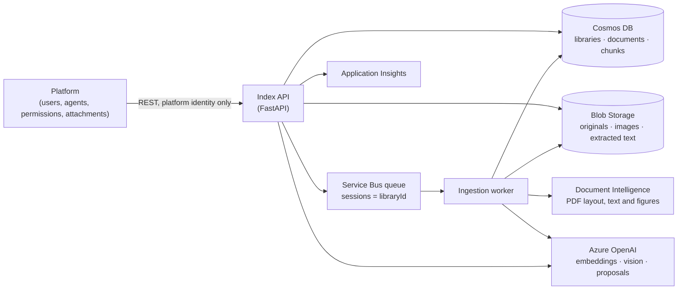

# Specification: File Library Index

*Version 0.18, 2026-10-27. Working name. Phases 0–3 passed on live Azure (`build-plan.md`). Adaptive document retrieval (§6.6) is implemented and its live smoke check passed; human answer-quality and broader routing evaluation remain pending. Images (Phase 3B, including PDF vector charts) are implemented; see `image-retrieval.md` for validation and limitations. Phases 4–5 remain to build. Every measured design choice is traced in `evidence.md`.*

## 1. Scope

The File Library Index (the **index**) replaces Azure AI Search as the store and search engine behind the platform's file libraries. It:

- accepts files into libraries, extracts their text and image content, embeds it, and stores it in Azure Cosmos DB;
- serves search requests from agents, one library per request, with optional metadata filters;
- returns text chunks, citations and images an agent can put into its context;
- lets an agent discover files and read complete extracted text, combining full files and selected passages in either order within one question (§6.6).

It does **not** decide who may do what. The **platform** (the existing agent product) remains the system of record for users, agents, roles and which libraries are attached to which agent. The index enforces exactly one rule on its own: a personal library answers only the agent it was created for (§5).

One deployment of the index serves one organization. Each organization gets its own Cosmos account.

### Terms

| Term | Meaning |
|---|---|
| Library | A named collection of files with a description. Either `shared` or `personal`. |
| Shared library | Created on the admin side. The platform may attach it to any number of official agents. |
| Personal library | Created for one personal agent. Bound to that agent for life. |
| Document | One uploaded file. |
| Chunk | A searchable piece of a document: about 500 tokens of text, or the description of one image. |
| Generation | A counter on a document that increases each time it is reprocessed. Chunks carry the generation that wrote them. |
| Facet | A `key=value` tag string on a document and its chunks, used for filtering. |
| Platform | The existing product that owns users, agents, permissions and attachments, and calls the index. |

## 2. Architecture



Two processes from one codebase and one container image:

- **Index API**: every endpoint in §6. Writes uploads to Blob, records documents, enqueues work, and runs searches.
- **Ingestion worker**: consumes the queue and does all slow work: extraction, chunking, image description, embedding, writing chunks, purging.

The division of storage is deliberate. **Cosmos holds the searchable representation** (chunk text, vectors, metadata, document and library records). **Blob holds bytes that are handed back** (original files, extracted images, and versioned complete extracted-text artifacts for full reads, §6.6). A Cosmos item is limited to 2 MB, and Blob storage costs a small fraction of Cosmos storage per GB.

## 3. Azure resources and identities

| Resource | Setting |
|---|---|
| Cosmos DB for NoSQL account | One per organization. Capability `EnableNoSQLVectorSearch`. `disableLocalAuth: true`. Session consistency. Continuous backup. Demo: add `EnableServerless`. Production: provisioned autoscale (§11). |
| Cosmos database | `fli`. No database-level throughput: vector containers cannot use shared throughput. |
| Containers | `libraries`, `documents`, `chunks`, defined exactly by `cosmos/*.json`. |
| Storage account | One blob container, `files`. Public blob access off. Blob soft delete for 7 days, matching Cosmos's continuous backup (`evidence.md` E16). |
| Service Bus | Standard tier (sessions need it). Queue `ingest`, sessions enabled, max delivery count 5, dead-lettering on. |
| Azure OpenAI | Embedding deployment of `text-embedding-3-large` at 3,072 dimensions. A vision-capable chat deployment for image descriptions and proposals. |
| Document Intelligence | `prebuilt-layout` with figure output for PDF text, tables, captions and figure crops; bounded `prebuilt-read` client retained for legacy extraction callers. |
| Application Insights | Telemetry and the routing report (§9.3). |
| Container Apps | Two apps from one image: `api` and `worker`. Local runs are fine for the demo. |

All service-to-service calls use managed identity (`DefaultAzureCredential`). No keys or connection strings.

| Identity | Roles |
|---|---|
| API and worker (one user-assigned identity is fine) | Cosmos DB Built-in Data Contributor (data-plane role assignment on the account); Storage Blob Data Contributor and Storage Blob Delegator (to issue short-lived read links); Azure Service Bus Data Sender and Data Receiver; Cognitive Services OpenAI User; Cognitive Services User (Document Intelligence) |
| Platform service principal (production, Phase 5) | The app role `Platform.Caller` on the index's API app registration. Nothing else. The prototype uses the static key instead (§5 rule 1) |
| Operator (demo only, optional) | The same roles as the API and worker, so `scripts/canary.py` and local runs work under the operator's own sign-in. Granted by `infra/main.bicep` when `operatorPrincipalId` is set; leave it empty in production |

## 4. Cosmos data model

Three containers, however many libraries exist. A new container is justified only by a different permanent layout (partition key, vector settings); never by a new library, user or filter.

The exact definitions are in `cosmos/libraries.container.json`, `cosmos/documents.container.json` and `cosmos/chunks.container.json`. They are deployable as-is (for example with Bicep `loadJsonContent()` as the container `resource`). Rules that apply to all three:

- **Explicit indexing only.** The root is excluded and each queried field is included by name. Indexing everything by default can make the index larger than the data.
- **Partition-key paths are included explicitly.** With the root excluded, Cosmos does not index them on its own, and queries on them would scan.
- **Never list `/id/?` in `includedPaths`.** Cosmos accepts the container create and then fails it asynchronously, out of sight. `id` is always indexed anyway.
- **Vector settings are permanent.** Dimensions, data type, distance function, index type, quantizer and shard key cannot be changed after creation. A change means a new container, rebuilt from the stored chunk text and the original files.

### 4.1 `libraries`

Partition key `/libraryId`. `id` equals `libraryId` (a GUID).

| Field | Type | Notes |
|---|---|---|
| `id`, `libraryId` | string | GUID, assigned by the index |
| `kind` | `shared` \| `personal` | Immutable |
| `boundAgentId` | string | Personal only, required; absent on shared. Immutable |
| `name` | string | |
| `description` | string | What agents see as the tool description. Platform-editable |
| `descriptionProposal` | object | `{text, generatedAt, basedOnDocumentCount}`, written by `proposeDescription` (§9.1). The index never copies it into `description`. Enhancement 1 |
| `autoAcceptTagProposals` | bool | Default `true` for personal, `false` for shared. When set, proposals fill empty fields and add tags at ingestion (§9.1) |
| `tagVocabulary` | object | `{key: {value: documentCount}}`, recomputed after ingestion |
| `filterValues` | object | `{authors, fileTypes, contentKinds: {value: documentCount}, period: {from, to} \| null, missing: {period, author, authoredAt}}`, counted over searchable documents and recomputed with `tagVocabulary`. The tool definition (§6.4) and coverage notes (§9.2) read it, so neither reads documents per search |
| `stats` | object | `{documentCount, chunkCount, imageCount, imagesSkipped, imageProcessingDocuments, imageFailedDocuments, lastIngestedAt}` |
| `embeddingModel`, `embeddingDimensions` | string, int | Recorded for rebuilds |
| `status` | `active` \| `deleting` | |
| `createdAt`, `createdBy`, `updatedAt` | | `createdBy` is the platform-supplied principal, for audit only |

### 4.2 `documents`

Partition key `/libraryId`. `id` equals `documentId` (a GUID).

| Field | Type | Notes |
|---|---|---|
| `id`, `documentId`, `libraryId` | string | |
| `fileName`, `contentType`, `fileType`, `sizeBytes`, `sha256` | | `fileType` is the normalized extension: `pdf`, `docx`, `pptx`, `xlsx`, `txt`, `md`, `html`, `csv`, `eml`, `msg`, `image` |
| `blobPath` | string | `{libraryId}/{documentId}/original/{generation}/{fileName}`: each generation's original has its own path, so a replacement never overwrites the one search still serves. Originals stored before Phase 3 have no generation segment and count as generation 1 (`evidence.md` E30) |
| `status` | `queued` \| `processing` \| `ready` \| `failed` \| `deleting` | The outcome of the latest processing attempt. It does not decide what search returns, except `deleting`; `activeGeneration` does (§8 step 6) |
| `statusDetail` | string | For `failed`: `encrypted`, `password_protected`, `unsupported_file_type`, `ocr_page_limit_exceeded`, `parser_error`, `too_many_chunks`, … |
| `generation` | int | The newest generation ever assigned. It only increases, so a generation number is never reused. The first upload sets it to 1; each replacement adds 1. Records written before Phase 3 lack it: read it as the largest of `activeGeneration`, `pendingGeneration` and 1 |
| `activeGeneration` | int \| null | The generation search may return. `null` until the first generation commits, so a document's chunks are never searchable half-written |
| `pendingGeneration` | int \| null | The generation being written. The first upload sets it to 1; a replacement sets it to the new `generation` |
| `pendingFile` | object \| null | `{fileName, contentType, fileType, sizeBytes, sha256, blobPath, uploadedAt, uploadedBy}` of a replacement until it commits. The record's own file fields describe the active generation, the one search returns; on commit the worker copies these over them (§7.2 step 9). `null` for a first upload and after a commit or failure |
| `uploadedAt`, `uploadedBy` | | System time; `uploadedBy` for audit only |
| `authoredAt`, `authoredAtSuspect` | datetime, bool | From file metadata. `authoredAtSuspect` is set when many documents in the library share one timestamp, which marks a bulk migration rather than real authorship |
| `author` | string \| null | |
| `periodStart`, `periodEnd` | date \| null | The period the document is **about**. Not the upload or authoring date |
| `tags` | array | `[{key, value, source: "user" \| "accepted-proposal"}]` |
| `tagProposals` | array | `[{key, value}]` awaiting acceptance (enhancement 1). Tags the document already has are not proposed |
| `periodProposal`, `authorProposal` | `{start, end} \| null`, `string \| null` | As for tags. Each ingestion replaces all three with its own proposals |
| `facets` | string[] | `key=value` for every entry in `tags`; this is what filters match |
| `metadataVersion` | int | Raised by each `PATCH`; the `retag` message carries it (§7.1). 0 at upload |
| `extraction` | object | `{method, ocrApplied, pageCount, extractionVersion, chunkingVersion}` |
| `chunkCount`, `imageCount`, `imagesSkipped` | int | Published chunks and indexed images; visual candidates omitted from semantic indexing |
| `publishedChunkCount`, `contentRevision` | int | Visibility bound within an active generation; revision 1 is text-first publication, 2 is final enrichment |
| `imageStatus`, `imagePendingCount`, `textReadyAt` | string, int, datetime | `none`, `queued`, `processing`, `ready`, or `failed`; pending count is images awaiting publication, not outstanding model calls |
| `imageAssets` | object or null | `{blobPath, generation, sourceSha256, sha256, assetCount, skipped}` for the immutable source image/caption manifest (§6.7, §7.5) |
| `sourceImageCount`, `sourceImagesSkipped` | int | Qualifying stored images and source-storage omissions, separate from semantic-index coverage |
| `processingMetrics` | object or absent | Current-generation worker stage times, chunk distribution, actual embedding usage and chunk-write RU (§6.4a). Older documents remain unmeasured |
| `fullText` | object | `{blobPath, generation, sectionCount, tokenCount, tokenizer, sha256}` for the active generation’s pre-chunking extracted sections (§6.6). Absent on older documents |
| `description` | string or null | Generated discovery hint from opening text, at most 800 characters; not a full-document summary (§6.6) |
| `updatedAt` | datetime | |

### 4.3 `chunks`

Hierarchical partition key `/libraryId` → `/documentId`. Vector shard key `/libraryId`. DiskANN index with the spherical quantizer, `indexingSearchListSize` 300, float16 vectors, cosine distance, 3,072 dimensions. Full-text index on `/text`, English.

Why this key: every search names one library, so `/libraryId` first sends a search straight to that library's data, and the shard key gives each library its own DiskANN graph. `/documentId` second makes everything about one document (reprocessing, deleting, fetching neighbouring chunks) a cheap single-partition operation, and keeps any logical partition far below Cosmos's 20 GB limit.

| Field | Type | Notes |
|---|---|---|
| `id` | string | `{documentId}:{generation}:{chunkIndex}`. Deterministic; retries address the same immutable content rather than adding duplicates |
| `libraryId`, `documentId`, `generation`, `chunkIndex` | | Text chunks are numbered 0…n−1 in reading order; image chunks follow, n…n+m−1 |
| `contentKind` | `text` \| `image` | |
| `text` | string | Chunk text; for images, the description (§7.5). Full-text indexed; returned to agents |
| `heading` | string \| null | Section heading carried into each chunk of its section |
| `location` | object | `{page}` \| `{paragraph}` \| `{slide}` \| `{sheet, rowStart, rowEnd}` \| `{}` |
| `imageRef` | string \| null | Blob path of the image, for `image` chunks |
| `imageMeta` | object \| null | `{width, height, mime, kind, caption, captionStatus, captionAssociation, captionLocation, regions}`; source captions remain distinct from generated descriptions |
| `fileName`, `fileType`, `uploadedAt`, `authoredAt`, `author`, `periodStart`, `periodEnd`, `facets` | | Copied from the document so filters run inside the vector search. Updated by patch when the document's metadata changes |
| `tokenCount` | int | |
| `embedding` | float[3072] | Stored as float16. Never returned by any query |
| `embeddingModel`, `chunkingVersion`, `createdAt` | | |
| `contentHash` | string | New worker writes: immutable content fingerprint checked on duplicate create. Retag fields remain patchable; no scalar index needed |

## 5. Permissions and the personal-library guarantee

The platform decides who may create, edit, attach and use libraries and agents, and it checks those permissions live, as it does today. **The index keeps no copy of those permissions.** A copy can go stale, and a stale permission leaks: if the index kept its own list of which agents may search a library, and that list lagged behind a detach in the platform, the detached agent could still search the library.

A fact that never changes cannot go stale, so the index holds exactly one: a personal library's `boundAgentId`.

**Rules:**

1. **Only the platform can call the index.** Agents and users never hold credentials to the index, so the `X-Agent-Id` header on a request can be trusted. **Production:** every request carries an Entra bearer token for the index's API app registration with the app role `Platform.Caller`, held only by the platform's service principal (Phase 5). **Prototype:** the platform is trusted by deployment. The API listens on the local machine and requires a static key (`AUTH_MODE=dev`, refused unless `ENVIRONMENT=local`). The platform authenticates its own users and decides who may see and add to which libraries, including exposing a personal library only to the agent it was created for; the index does none of that.
2. **Creating a library fixes its kind.** `kind: personal` requires `boundAgentId`; `kind: shared` forbids it. Neither field can change afterwards: `PATCH` with either returns `400 immutable_field`. Making a personal library shared means copying it into a new shared library (not in v1), never flipping the field.
3. **Every agent retrieval capability checks the binding.** Search, document discovery, complete reads, selected-page image reads and the `/tools` bundle require `X-Agent-Id` and apply this rule. Even though the platform exposes a personal library only to its own agent, the index re-checks as a backstop. Before searching, the index reads the library record (a point read, about 1 RU). It refuses when:
   - the library does not exist or is `deleting` → `404 library_not_found`;
   - the library is `personal` and `X-Agent-Id` ≠ `boundAgentId` → `403 library_not_bound_to_agent`, logged as a security event.
4. **The platform's attach screen for official agents lists only shared libraries** (`GET /v1/libraries?kind=shared`). Rule 3 is the backstop: a wrong attachment created by a platform bug returns nothing.
5. **Deleting refuses first and purges second.** `DELETE` sets `status: deleting` at once, so searches stop immediately (in the API process that handled the delete; across API instances, `evidence.md` N13); chunks, document records and blobs are purged in the background. The same holds per document (§7.8). Repeating `DELETE` on a library or document already `deleting` returns `202` and queues the purge again. This is the retry path when the queue send fails (`503 queue_unavailable`) or a purge dead-letters (`evidence.md` E28).

Shared libraries have no index-side binding check. Which official agents may search a shared library is entirely the platform's decision.

## 6. API

Base path `/v1`. JSON throughout except uploads. Errors: `{"error": {"code": "...", "message": "..."}}`.

### 6.1 Libraries

| Method and path | Body / query | Result |
|---|---|---|
| `POST /v1/libraries` | `{kind, boundAgentId?, name, description}` | `201` library |
| `GET /v1/libraries` | `?kind=shared\|personal&status=active` | List (for the platform's attach screen) |
| `GET /v1/libraries/{libraryId}` | | Library, including `descriptionProposal`, `tagVocabulary`, `stats` |
| `PATCH /v1/libraries/{libraryId}` | `{name?, description?, autoAcceptTagProposals?}` | Library |
| `DELETE /v1/libraries/{libraryId}` | | `202`; status `deleting`. Repeatable: queues the purge again (§5 rule 5) |
| `POST /v1/libraries/{libraryId}/description:propose` | | `202`; queues `proposeDescription` (§7.1). `404 library_not_found` if the library does not exist or is `deleting`; `503 queue_unavailable` |
| `GET /v1/libraries/{libraryId}/tool` | | A ready-to-attach tool definition (§6.4) |

### 6.2 Documents

| Method and path | Body / query | Result |
|---|---|---|
| `POST /v1/libraries/{libraryId}/documents` | multipart: `file`, optional `metadata` JSON `{author?, periodStart?, periodEnd?, tags?}` | `202 {documentId, status: "queued"}` |
| `GET /v1/libraries/{libraryId}/documents` | `?status=&facet=` | List |
| `GET /v1/libraries/{libraryId}/documents/{documentId}` | | Document, including proposals |
| `PATCH /v1/libraries/{libraryId}/documents/{documentId}` | `{author?, periodStart?, periodEnd?, tags?, acceptProposals?: ["region=EMEA", "period", "author"], dismissProposals?: [...]}` | Document; chunk metadata updated by a `retag` job (§7.7) |
| `PUT /v1/libraries/{libraryId}/documents/{documentId}/content` | multipart `file` | `202 {documentId, status: "queued", generation}`; reprocesses as a new generation (§7.8) |
| `DELETE /v1/libraries/{libraryId}/documents/{documentId}` | | `202`; status `deleting`. Repeatable: queues the purge again (§5 rule 5) |
| `GET /v1/libraries/{libraryId}/documents/{documentId}/file` | | `302` to a 15-minute read-only link |

Uploads are refused with `409 library_deleting` when the library is `deleting`. Maximum upload size is configurable (default 100 MB).

A replacement (`PUT …/content`) is refused with `404 document_not_found` when the document does not exist or is `deleting`, `409 library_deleting` when the library is, `413 file_too_large` and `400 empty_file` as for uploads. It reserves the next `generation` on the record first, then stores the original under that generation's path, then queues `ingest`. Reserving first means two concurrent replacements never write the same path. If the original cannot be stored, or the message cannot be queued (`503 queue_unavailable`), the replacement alone is marked `failed` (`upload_failed`, `enqueue_failed`) and its original removed; the active generation stays searchable. A replacement sent while another is pending supersedes it: the worker abandons the older one.

A metadata update (`PATCH`) changes only the fields it names. `tags` replaces the list: a tag kept from before keeps its `source`, a new one is `user`, and `facets` is recomputed. `periodStart` and `periodEnd` go together. It is refused with `404 document_not_found` and `409 library_deleting` as for replacements. The record changes at once; `retag` then copies the change to the chunks (§7.7). Until it runs, filters match the chunks' previous metadata. If `retag` cannot be queued, the update is kept and the response is `503 queue_unavailable`; repeating the request queues it again.

`acceptProposals` and `dismissProposals` name current proposals: `key=value`, `period` or `author`. An accepted tag joins `tags` with `source: accepted-proposal`; an accepted period or author is set as if sent. Either way the proposal is removed. Fields sent explicitly apply first, and accepted tags are added to them. To edit a proposal, send the edited value as a field and dismiss the proposal. A request is refused with `400 invalid_request` when it names a proposal the document does not currently have (it may have been regenerated or resolved meanwhile), names one in both lists, or accepts `period` or `author` while also setting that field. A `PATCH` that only dismisses changes nothing filters match: it does not raise `metadataVersion` and queues no `retag`.

### 6.3 Search

`POST /v1/libraries/{libraryId}/search`, header `X-Agent-Id: <agentId>` (required on every search).

```json
{
  "query": "What drove the change in gross margin in EMEA?",
  "filters": {
    "period": { "from": "2025-10-01", "to": "2025-12-31" },
    "authoredBetween": { "from": "2025-01-01", "to": "2026-03-31" },
    "uploadedBetween": null,
    "authors": ["Jane Doe"],
    "tags": ["region=EMEA"],
    "fileTypes": ["pdf", "pptx"],
    "contentKinds": ["text", "image"]
  },
  "top": 8,
  "includeNeighbors": true
}
```

Every filter is optional. Three time filters exist because "when" means three different things, and none substitutes for another:

- `period`: documents whose `periodStart`–`periodEnd` overlaps the window. This is what "documents about Q4 2025" means. Documents with no period are not matched, and the response says so.
- `authoredBetween`: `authoredAt` in the window.
- `uploadedBetween`: `uploadedAt` in the window.

`tags` must all match. `authors`, `fileTypes` and `contentKinds` match any listed value. `top` defaults to 8, maximum 20.

A window may give `from`, `to` or both; dates are inclusive, and an open side is unbounded. `tags` are `key=value`. `fileTypes` takes the normalized types of §4.2, and `contentKinds` `text` or `image`. Each list holds at most 20 values. Anything else is `400 invalid_request`.

Response:

```json
{
  "library": { "libraryId": "…", "name": "Finance — Quarterly Reports" },
  "coverage": {
    "searched": "Finance — Quarterly Reports (412 documents)",
    "filtersApplied": { "period": "2025-10-01..2025-12-31", "tags": ["region=EMEA"] },
    "notes": ["Documents without a period set are not included when filtering by period."],
    "resultCount": 6,
    "disposition": "results"
  },
  "results": [
    {
      "rank": 1,
      "chunkId": "…",
      "documentId": "…",
      "fileName": "Q4-2025-EMEA-review.pptx",
      "location": { "slide": 7 },
      "heading": "Margin bridge",
      "contentKind": "text",
      "text": "…",
      "neighbors": [ { "chunkIndex": 11, "text": "…" }, { "chunkIndex": 13, "text": "…" } ],
      "image": null
    },
    {
      "rank": 2,
      "contentKind": "image",
      "fileName": "Q4-2025-EMEA-review.pptx",
      "location": { "slide": 8 },
      "text": "Bar chart titled 'Gross margin by region, Q4 2025'…",
      "image": { "url": "https://…?sv=…", "expiresAt": "…", "width": 1280, "height": 720, "mime": "image/png" }
    }
  ],
  "usage": { "requestCharge": 12.4, "totalMs": 210.5 },
  "telemetryId": "…"
}
```

- `usage` reports what this search cost: `requestCharge` is the Cosmos request units summed over every Cosmos call the search made: the library read, the chunk query, the generation check's document reads (§8 step 6) and neighbours. `totalMs` is the server-side time. It is for the platform's display and cost tracking; it carries no content.
- `disposition` is `results` (3 or more), `thin` (1–2) or `empty` (0). An empty result is reported as empty; nothing is padded.
- `notes` says what a filter left out: how many documents lack the filtered field (`period`, `authoredBetween`, `authors`), and any filter value no document in the library has. It also reports passages the generation check left out (§8 step 6).
- No scores are returned. Hybrid ranking fuses rank positions, so its scores are not comparable across queries and must not be thresholded.
- `image.url` is a 15-minute read-only user-delegation SAS link. The platform fetches it to show the image to the user, and to put the image into the agent's context when the agent's model accepts images.

### 6.4 Tool definition

`GET /v1/libraries/{libraryId}/tool` returns a function-calling tool definition the platform attaches to an agent as-is. One tool per attached library.

```json
{
  "type": "function",
  "function": {
    "name": "search_library_finance_quarterly_reports",
    "description": "<library.description>\n\nFilters available in this library: tags region=(EMEA, APAC, NA), topic=(margin, headcount, capex); authors (Jane Doe, Sam Lee); documents cover periods 2024-01-01 to 2025-12-31; file types pdf, pptx, xlsx. Use 'period' for what a document is about, 'authoredBetween' for when it was written.",
    "parameters": {
      "type": "object",
      "properties": {
        "query": { "type": "string", "description": "What to look for, in natural language." },
        "period": { "type": "object", "properties": { "from": { "type": "string", "format": "date" }, "to": { "type": "string", "format": "date" } } },
        "authoredBetween": { "type": "object", "properties": { "from": { "type": "string", "format": "date" }, "to": { "type": "string", "format": "date" } } },
        "authors": { "type": "array", "items": { "type": "string", "enum": ["Jane Doe", "Sam Lee"] } },
        "tags": { "type": "array", "items": { "type": "string", "enum": ["region=EMEA", "region=APAC", "region=NA", "topic=margin", "topic=headcount", "topic=capex"] } },
        "fileTypes": { "type": "array", "items": { "type": "string", "enum": ["pdf", "pptx", "xlsx"] } }
      },
      "required": ["query"]
    }
  }
}
```

Filters are offered only when they can narrow the search: tags, authors, `period` and `authoredBetween` when some document has a value; `fileTypes` and `contentKinds` when the library holds more than one. The description's "Filters available" sentence lists only the offered filters. `uploadedBetween` is an API filter only. The tag and author values are an `enum` built from the library's actual vocabulary (`tagVocabulary`, `filterValues`), so the agent picks real values instead of inventing them. When a library has more than 100 tag or author values, that enum is dropped and the description lists the 50 most used. The tool name is a slug of the library name, made unique per agent by the platform if needed. The platform maps a tool call back to `POST …/search` with the tool's `libraryId` and the calling agent's `X-Agent-Id`; the library is never an agent-supplied argument.

### 6.4a Prototype performance views

`GET /v1/libraries/{libraryId}/metrics` returns current inventory, per-document generation measurements, and a bounded retrieval/ingestion event history. It requires the platform credential and `X-Agent-Id` and applies §5's binding backstop. `processingMetrics` on documents captures worker stage times, chunk/token distribution, provider-reported embedding usage/retries and chunk-write RU; older generations without instrumentation remain explicitly unmeasured. Query embedding usage is also included in search's `usage`.

The demo exposes **Library Performance** and per-answer model/retrieval breakdowns in Chat. Model tokens are cumulative across the turn, with cached/reasoning subsets reported separately when available. A turn can use multiple libraries, so model usage is not allocated artificially to one library.

`FLI_METRICS_FILE` is an optional content-free single-host journal shared by prototype API/worker processes, outside the repository. It adds no Cosmos telemetry writes; the dashboard scans at most 4 MiB / 2,000 matching events and labels that window. `DEMO_METRICS_FILE` optionally captures generic per-turn metrics externally. Neither sink writes source text/prompts. This is not the future production Log Analytics routing report. The full measurement definitions, exclusions, configuration and validation are in [observability.md](observability.md).

### 6.5 Search usage (enhancement 3)

`POST /v1/search-events/{telemetryId}/usage` with `{"usedChunkIds": ["…"]}`. Optional. The platform calls it after a turn to report which results the agent actually cited. `204`.

### 6.6 Adaptive document retrieval

`GET …/tools` returns four ready-to-attach function definitions: passage search, file discovery, complete-document reading, and selected-page PDF image reading (§6.7). The singular `/tool` remains search-only for compatibility. The platform binds every definition to one attached library and supplies `X-Agent-Id`; the model supplies neither library ID nor agent ID. A REST or MCP host can present these definitions; this implementation uses REST and adds no MCP server.

| Method and path | Body | Result |
|---|---|---|
| `GET /v1/libraries/{libraryId}/tools` | — | `{tools: [...]}`, with the personal-library backstop |
| `POST …/documents:discover` | `{filters?, fileNames?, fileNameContains?, after?, limit?}` | Bounded catalogue page `{documents, hasMore, nextAfter, coverage, usage}` |
| `POST …/documents:read` | `{documents: [{documentId, generation?}], includeText?: true, maxTokens?: 32000}` | Complete extracted sections for every selected file, or no text and an explicit budget/error result |

The agent chooses and revises the evidence scope from the user's intent: passage retrieval for localized facts, complete text for full summaries/critiques or explicit whole-file requests, and a mixture whenever needed. Both full files → supporting passages and passages → complete parent files work within one turn and can repeat. The agent does not routinely ask permission for these choices; it clarifies meaningful ambiguity or an inability to meet the requested scope. Best-answer quality takes priority over saving tokens. Full reads and passages share the same remaining context budget.

Discovery filters document records directly, by the same author/tag/file-type/date/period semantics as search, plus case-insensitive exact filenames or literal name fragments. Names may be duplicated; return distinct IDs. It includes unreadable uploads so an “all matching files” answer can disclose them. Deleting documents are excluded. Follow `nextAfter` with unchanged selectors until `hasMore=false`; defaults to 50 records, maximum 100, ordered by ID. Pagination is not a concurrent snapshot. Semantic top hits are candidates, not an exhaustive document set. Search results now also carry their active `generation`, and the demo preserves both this and `documentId` for subsequent reads.

Read takes 1–20 distinct IDs, optionally pinned to active generations. It returns all stored extracted sections, headings and locations in reading order, with no per-section truncation, or no text from the batch if its projected serialized size exceeds `maxTokens` (maximum 200,000). `includeText=false` returns inspection manifests/estimates without adding file text to model context. The reader reports `complete`, `disposition` (`complete`, `inspected`, `budget_exceeded`), `estimatedTokens`, `tokenizer`, and usage. A token estimate is not a dollar-price, time or model-token guarantee. An oversized file cannot be made to fit by silently clipping it.

The worker stores pre-chunking sections at `{libraryId}/{documentId}/text/{generation}/sections.json` in Blob and commits their descriptor with the generation. It validates their digest and section count on reading. Artifacts follow generation replacement/deletion/purge rules. Old documents can return all active indexed chunks, count/index checked and labelled `indexed_chunks`, with overlap/repeated-heading disclosure. This fallback is complete indexed text, not reconstructed original layout. A complete text read does not imply visual figures, attachments or unsupported content were extracted.

The reader rechecks every document's active generation, content revision, metadata version and deletion state, and library availability after fetching. A detected change refuses the batch (`409 document_changed`). A missing/deleting file is `404 document_not_found`; no active generation is `409 document_not_ready`; unavailable/incomplete text is `409 document_text_unavailable` / `document_text_incomplete`. No error returns another selected file's contents. Existing cross-client Session-consistency limits (N13) still apply.

The demo adopts `/tools`, passes full reads without its passage character cap, keeps all tool evidence during a turn, and applies a configurable total context budget (default 64,000, with an answer reserve). It shows operation, completeness and estimated tokens alongside RU and latency. Generated per-document descriptions (when proposals run) identify subject/purpose from opening text and are labelled as discovery hints. They are never substitutes for reading the file.

The complete contract, examples, integration mapping, compatibility, tests and rollout limits are in [document-retrieval.md](document-retrieval.md). The implementation and a live four-paper smoke check passed; broad answer-quality evaluation remains outstanding (E34, E35).

### 6.7 Stored image/caption retrieval

Source image bytes and associated caption metadata are ingested together before publication. An immutable generation-local `image-assets.json` manifest and its descriptor bind source SHA, generation, image IDs/Blob references, caption text or explicit absence, association/location and omissions by page. The descriptor publishes with the document's text/source snapshot. Captions are also part of searchable image text before embedding. `IMAGE_MAX_PER_DOCUMENT` (50) limits model descriptions/semantic image chunks; `IMAGE_ASSET_MAX_PER_DOCUMENT` (1,000, hard maximum 10,000) separately bounds stored source figures. Metadata-only PDF handles and serial native-picture uploads bound PNG memory use. Description enrichment also loads one stored crop at a time and reuses its immutable Blob reference (E44).

`POST …/documents:images` accepts `{documentId, generation?, pages}` with 1–3 distinct PDF page numbers. The bound tool is `get_images_library_<name>`. It reads the stored manifest, source figures and extracted text, returning up to 10 image/caption pairs plus page text with `scope: stored_pdf_page_images`. A missing/invalid legacy manifest explicitly requires reprocessing. It makes no layout/model calls and performs no storage writes. Permission, integrity and lifecycle checks apply equally to source assets beyond the semantic-description cap. `sourceImageCount` and `sourceImagesSkipped` disclose stored coverage separately from indexed image counts.

The agent receives captions together with images and includes them by default. It may omit display when appropriate; the demo rendering convention is `fli-image:IMAGE_ID?caption=omit`. Contextual headings and internal figure locators must not be represented as source titles/captions. Caption associations inferred during ingestion remain qualified. There is no automatic post-answer caption lookup or caption-driven answer revision. This supersedes the earlier E42 prototype recovery workflow without changing Cosmos partition/index policies.

Text passages and image descriptions share semantic ranking by default; text passages do not automatically attach every nearby image. Agents may place a relevant figure inline with a text-based explanation without an explicit request for a picture. Reuse returned image/caption evidence before requesting additional source pages. Direct reads beyond the semantic-description cap currently support PDF pages; stored unindexed Office pictures require a higher description cap and reprocessing, or PDF export.

## 7. Ingestion

### 7.1 Queue

One Service Bus queue, `ingest`, with text publication and deferred image enrichment messages, with sessions enabled and `SessionId = libraryId`. Messages for one library are processed one at a time, in order; different libraries proceed in parallel up to `INGEST_MAX_CONCURRENT_SESSIONS` (default 8). This is the pacing mechanism: one user dropping 5,000 files into one library occupies one lane and cannot starve everyone else's uploads or searches.

| Message `type` | Fields | Effect |
|---|---|---|
| `ingest` | `libraryId, documentId, generation` | Process a document (§7.2). If the document's `generation` reads lower than the message's, the read is stale (`evidence.md` E28): the worker pauses a second and the message is redelivered |
| `enrichImages` | `libraryId, documentId, generation` | Resume image descriptions from immutable preparation/checkpoints, append image chunks and atomically publish the enriched snapshot. Text remains searchable during this work |
| `retag` | `libraryId, documentId, metadataVersion` | Copy the document's `facets`, `author`, `periodStart` and `periodEnd` to the chunks of its active and pending generations, by patch, under the worker-wide write cap (§7.7). If the record's `metadataVersion` reads lower than the message's, the read is stale (`evidence.md` E28) and the message is redelivered; if higher, a later `retag` is queued and this one completes without work. A `retag` that fails on its last delivery is logged as `retag dead-lettered`; repeating the `PATCH` queues it again |
| `purgeDocument` | `libraryId, documentId, deleted?` | Delete every chunk and original of an obsolete generation: one that is neither `activeGeneration` nor `pendingGeneration`, and not above the document's `generation` (a stale read may miss a newer generation, so what lies above is left for a later purge; E30). If the document is `deleting` or gone, delete all its chunks, then its blobs, then its record. Safe because one library's messages never run concurrently (session order). `deleted: true` marks a purge queued by a deletion: if the document does not read as `deleting` yet, the read is stale (`evidence.md` E28), so the worker pauses a second and the message is redelivered instead of completing |
| `purgeLibrary` | `libraryId` | Delete every document, chunk and blob, then the library. If the library does not read as `deleting` yet, the read is stale (E28): retried as for `purgeDocument` |
| `proposeDescription` | `libraryId, requested?` | Propose a library description (§9.1). `requested: true` marks `POST …/description:propose` and always regenerates. Without it (queued by step 11), the worker checks again that a proposal is due and otherwise completes without a call, so a burst of uploads costs one call. One that fails on its last delivery is logged as `proposeDescription dead-lettered`; the previous proposal stays |

An `ingest` whose generation is no longer pending is completed without processing. It first queues `purgeDocument` again, including when the record is deleting or gone (late writers can leave cleanup work), and if its generation is the active one it also refreshes the library's `stats` (step 11). Messages arrive at least once, and such a delivery may be the retry of one that committed and then failed to queue its purge; the purge is idempotent. After the last delivery attempt fails, the worker marks the document `failed` with the reason before the message dead-letters. `activeGeneration` is left as it was: a failed replacement keeps the previous version searchable, and a failed first upload has nothing searchable. A purge that fails on its last delivery is logged as `purge dead-lettered`. Its library or document stays hidden as `deleting` until the `DELETE` is repeated (§5 rule 5); alerting on that log is Phase 5.

### 7.2 Processing a document

1. Load the document; set `status: processing`. Proceed only while `pendingGeneration` is G.
2. Download the original from Blob: `pendingFile.blobPath` for a replacement, `blobPath` for a first upload.
3. Extract (§7.3). Encrypted, password-protected, unsupported and failed files end here with `status: failed` and a `statusDetail`, PDFs without body text can still publish usable figures from layout analysis. Layout page bounds and parser/protection failures are enforced.
4. Chunk the text (§7.4). A document with more than `INGEST_MAX_CHUNKS_PER_DOCUMENT` chunks ends here with `status: failed`, `too_many_chunks`, before anything is embedded (`evidence.md` E29).
5. Extract and store qualifying source images with captions (§7.5). Defer model descriptions until after text publication for mixed documents.
6. Propose tags, period, author and a bounded discovery description from opening text (§9.1, §6.6). If the library has `autoAcceptTagProposals`, the accepted values go into the chunks written in step 8. A failed proposal call does not fail the document: it is logged, and the document proceeds without proposals.
7. Freeze source/text preparation using a create-only Blob at `text/{generation}/preparation.json`. For mixed text/image files, embed/write/publish the complete text now and queue image enrichment (details below). Enrichment freezes the final canonical plan at `text/{generation}/plan.json`. It contains the source SHA, sections/chunks/image references and metadata proposals. Concurrent attempts read the winning plan. A redelivery with a saved plan skips extraction, descriptions and proposals. Embed only unpublished chunks with the embedding deployment, in batches of 16, honouring `Retry-After` on 429; enrichment does not re-embed ready text.
8. Create all chunks of generation G with a content fingerprint; a duplicate ID must have the same fingerprint and is left untouched. Legacy/import callers without that marker retain upsert behavior. Writes share one cap across the whole worker, `COSMOS_WRITE_CONCURRENCY` (default 2), not a cap per document. On a 429 that outlasts the SDK's own retries, wait `x-ms-retry-after-ms` and retry. Eight concurrent writers exhausted the SDK's retries on serverless within about 100 writes (`evidence.md` E10). The frozen plan plus create-only writes make retries safe without reverting published evidence or retagged metadata.
   Before commit, create the canonical pre-chunking-section Blob conditionally and verify its hash on conflict; record its descriptor (§6.6). Image paths include normalized-pixel hashes.
9. Commit: set `activeGeneration: G`, `pendingGeneration: null`, `status: ready`, counts; copy `pendingFile` over the record's file fields and clear it. `authoredAt` is taken from the file of generation G, since it only ever comes from the file; `author` keeps any value already set. Until this moment search keeps returning the previous generation, if any; from it, search returns generation G and ignores older ones (§8 step 6). The step 6 proposals are settled on the record as it reads now, so a `PATCH` made meanwhile is kept, and its `retag` follows in session order.
10. If G > 1, enqueue `purgeDocument`. It also runs after a generation is abandoned (the document was deleted or replaced while G was written) and after a final failure, so half-written chunks never linger.
11. Recompute the library's `tagVocabulary`, `filterValues` and `stats` from the `documents` container (a single-partition query). Enqueue `proposeDescription` when the library has no proposal yet, when its document count has moved by 10 or more since the last proposal, or when 24 hours have passed and the count has changed.

**Text-first publication (E41).** The worker freezes `preparation.json` containing complete source sections, canonical text chunks, proposals and stored figure references before describing images. For mixed text/image files, it embeds and publishes the entire extracted text first, at `text-sections.json`. `activeGeneration` and file metadata switch to the new upload together; `pendingGeneration` remains that generation while images are pending. `status: processing`, `imageStatus: queued|processing`, `imagePendingCount`, `textReadyAt` and `contentRevision: 1` describe this state. Complete reads are complete extracted text with explicit `visualsComplete: false` and an image-coverage note.

It then queues `enrichImages` on the same library session, behind already queued uploads. Image-only files have no earlier text to publish and use the ordinary image path. Enrichment reuses stored figures/descriptions, embeds only appended image chunks, freezes the final plan and `sections.json`, then atomically updates the document to `contentRevision: 2`, the full count and `imageStatus: ready`. Text chunks/embeddings keep their IDs and are not rewritten. Queries retain the existing generation check plus the optional `publishedChunkCount` bound; newly written image chunks remain hidden until final publication. Complete reads recheck content revision as well as generation/metadata, refusing mixed snapshots.

Image failure after text publication leaves `status: ready`, `imageStatus: failed` and the reason; text remains usable. Library coverage and manifests disclose pending/failed image enrichment. Unpublished same-generation artifacts remain inaccessible and follow that generation's eventual purge. Failed extraction/text publication retains the earlier failure behavior. Replacement/deletion/supersession guards apply to both stages, and retries repair a failed enqueue without republishing or re-embedding ready text. Existing all-at-once plans remain compatible. No Cosmos container/index change is required.

### 7.3 Extraction

| File type | Method |
|---|---|
| PDF | Protection/metadata inspection via `pypdf`, then Document Intelligence `prebuilt-layout` text, tables, figures and captions, including scanned pages; `PDF_LAYOUT_MAX_PAGES` (default 2,000), checkpointed page batches (default 20) |
| DOCX | `python-docx`: paragraphs with heading styles as section headings; tables as rows. Embedded images from `word/media/` |
| PPTX | `python-pptx`: one section per slide (title as heading), body text and speaker notes. Picture shapes as images, with slide number |
| XLSX, CSV | `openpyxl` / `csv`: one section per sheet; rows rendered as `Header: value` lines; header row repeated in every chunk |
| TXT, MD, HTML | Markdown headings / HTML headings as sections |
| EML | Python `email`: subject as heading, sender, recipients, date (as `authoredAt`), body. Attachment names listed in the text; attachments are not processed in v1 |
| MSG | `extract-msg`, same as EML |
| PNG, JPEG, GIF, WEBP, TIFF, BMP | Image path only (§7.5); OCR text from the vision description |
| Legacy DOC, PPT, XLS | `failed`, `unsupported_file_type` in v1 |

A file that cannot be parsed is `encrypted` or `password_protected` only when it shows a sign of protection: an Office encryption container, or a PDF `/Encrypt` dictionary. Otherwise it is damaged or not what its name says, and fails as `parser_error` (`evidence.md` E33).

`authoredAt` and `author` come from document core properties (Office), PDF metadata, or email headers. Start from `src/fli/extraction.py` (§13), which already does native-first extraction with OCR fallback, detects encrypted and password-protected files, and records page, slide and sheet locations.

### 7.4 Chunking

Section-aware chunks of about 500 tokens with about 50 tokens of overlap, measured with the `cl100k_base` tokenizer (the one `text-embedding-3-large` uses). Overlap is whole trailing sentences; a sentence is split only if it alone exceeds the target. Headings are carried into every chunk of their section. An email of 700 tokens or fewer is one chunk. Spreadsheet chunks break on row boundaries. Start from `src/fli/chunking.py` (§13), and record `chunkingVersion` on every chunk.

The heading carried into each chunk is at most 64 tokens. A longer heading is almost always a paragraph styled as one: the chunk carries its first 64 tokens, and its full text opens the section body, so it is indexed once (`chunking-v1.1`, `evidence.md` E29).

### 7.5 Images

1. Collect standalone images and pictures embedded in DOCX/PPTX, including tables/groups. For PDFs, use Document Intelligence `prebuilt-layout` with `output=figures` and download its individual figure crops (`kind: pdf_figure`). Neither a page-sized scan nor a PDF path/image object independently becomes a figure. Body paragraphs and table text remain ordinary text; graphic-internal labels stay with the figure. Retain source captions both as body text and as separately attributed figure metadata/context. Record page/figure identity and source/caption bounding regions. No whole-page fallback. Legacy `pdf_page` generations remain readable. Native Office chart objects/unsupported media remain outside picture extraction; PDF export enables layout-based extraction (E40).
2. Skip images with fewer than `IMAGE_MIN_PIXELS` pixels (default 16,384) or smaller than `IMAGE_MIN_BYTES` (default 0, disabled). An explicitly enabled byte threshold trades recall for cost (E39). Keep at most `IMAGE_MAX_PER_DOCUMENT` (50), counting other candidates in `imagesSkipped`; store qualifying source figures/captions up to `IMAGE_ASSET_MAX_PER_DOCUMENT`, but describe/index only the first description-cap images. All pages still receive text extraction. Normalize kept images to PNG with EXIF orientation and first-frame selection; skip inputs above 40 million pixels and bound display dimensions to 4,096 pixels.
3. Store each qualifying source image and its caption metadata together, and freeze their generation-bound manifest before publication (§6.7). Store image bytes at `{libraryId}/{documentId}/images/{generation}/{imageId}.{ext}`. Image ids and extensions are generated, never taken from the file. Like originals, each generation's images have their own path, and the purge removes those of obsolete generations by the same rule (§7.1).
4. Load one stored image at a time and describe it with the vision deployment; reuse its Blob reference without uploading it again. Run PDF normalization off the event loop so concurrent library lanes can progress. Prompt: describe what the image shows for someone searching for it; transcribe any visible text, numbers, labels, axis titles and legends; for charts, state the chart type, what is compared and the main trend; do not speculate beyond what is visible. Give it the document name, nearest heading or slide title, source location, any separately attributed source caption and up to 2,000 characters of nearby text as untrusted context. Keep that source context with its searchable description. Persist each successful description using a create-only, generation-local checkpoint keyed by pixel hash, context/location/name, prompt version and model configuration. Retried work reuses it.
5. Include the retained images as description-bearing sections in the complete extraction artifact, with their image IDs, source locations and internal Blob references. Full reads turn those references into fresh links without exposing internal paths. Text sections precede visual sections; both preserve provenance and the all-or-nothing budget.
6. The chunk `text` is `"Image from <fileName>, <location>, under '<heading>': <description>"`, `contentKind: image`, with `imageRef` and `imageMeta`. It is embedded with the same model as text, so one search covers both.

Search and complete reads return `imageId` and `image: {url, expiresAt, width, height, mime, kind, caption, captionStatus, captionAssociation, captionLocation, regions}`. The platform supplies actual visual content parts to image-capable models and displays selected images inline; descriptions remain useful to text-only agents. See `image-retrieval.md` for the complete platform contract, skip limits, generation behavior and verification.

Describing and then embedding keeps one vector space, lets keyword search work on images, and gives a text-only agent something useful to read. A vision call per image is the largest per-file cost in the pipeline, which is why the skip rules and cap exist.

### 7.6 Concurrency and throttling

PDF layout uses page-range batches with create-only checkpoints of text, caption metadata and copied figure bytes. Verify exact page coverage before saving a batch. A shared governor permits two active layout operations per worker process and honors throttling. Layout is billed per analyzed page separately from the image cap; selected-page requests currently resubmit the original bytes. Missing configuration fails as `layout_unavailable`.

Vision calls share a `VISION_CONCURRENCY` governor (default 2) across worker lanes, with provider-directed retries and shared cooldown. Checkpoints avoid re-describing completed images on redelivery; overlapping misses can still call vision concurrently.

Cosmos throttles with HTTP 429 when a partition's throughput is exceeded. The SDK retries; the worker additionally retries 429s that outlast the SDK's retries, and backs off on repeated ones. Ingestion is the expensive side (about 144 RU per chunk written at float16, `evidence.md` E10), so the session lanes (§7.1) decide which library's work runs next, and the worker-wide write cap (§7.2 step 8) keeps ingestion below the container's ceiling, leaving room for searches. On a provisioned account, raise `COSMOS_WRITE_CONCURRENCY` with the configured throughput.

### 7.7 Metadata changes

`PATCH` on a document updates the document record at once, then enqueues `retag`, which patches `facets`, `author`, `periodStart` and `periodEnd` on every chunk of the active and pending generations (a single-partition query by `libraryId` + `documentId`, then partial-update operations). The pending generation is a replacement in flight; older generations are never searchable and await their purge. A patch costs about 80 RU per chunk, a little over half a write (`evidence.md` E32; a write is about 144 RU, E10), so retagging a 239-chunk document costs about 19,000 RU. The worker's `retag done` log line reports it.

### 7.8 Deletion and replacement

- **Document delete:** set `status: deleting` (search drops its chunks immediately, §8 step 6), then `purgeDocument`, which deletes the chunks, the blobs and the document record.
- **Replacement (`PUT …/content`):** `generation + 1`, the new original under that generation's own path, `ingest` (§6.2). The old generation stays searchable until the new one commits. Then `purgeDocument` deletes its chunks and its original; blob soft delete keeps the original recoverable for 7 days, like any deleted blob. Only the active generation's original is kept for rebuilds (E16).
- **Library delete:** set `status: deleting` (search refused immediately, §5), then `purgeLibrary`.
- **Retention:** a delete removes a document from the library and from search at once. Blob soft delete and Cosmos continuous backup keep deleted data recoverable by an operator for 7 days; after that it is gone.

## 8. Search execution

1. Authenticate the platform (§5 rule 1). Validate the body.
2. Point-read the library. Apply §5 rule 3.
3. Embed `query` with the embedding deployment (3,072 floats). **Convert it for the float16 index:** round each value to float16, and set every value whose magnitude is below 2⁻¹⁴ (float16's subnormal range) to 0. The service returns no distance for a float16 query that contains a subnormal.
4. In `hybrid` mode only, extract lexical terms: lower-cased alphanumeric tokens, de-duplicated, at most 16.
5. Run one query against `chunks`. `SEARCH_MODE` chooses its form (`evidence.md` E27):

   - **`vector` (default):** `ORDER BY VectorDistance(…)` alone, routed by the library prefix of the partition key (`partition_key=[libraryId]`). One HTTP response; Phase 1 measured 8–16 RU on a 5,535-chunk library.
   - **`hybrid`:** the `RRF` query below, sent **without** a partition key: the library is named in `WHERE` only. With a partition key the Python SDK skips the query plan that ranking needs, and Cosmos silently returns the first `TOP` items unranked. Without it the SDK runs its hybrid pipeline (query plan, full-text statistics, component queries, fusion): four HTTP responses and 128–191 RU in Phase 1. The full-text statistics cover the whole container, not the library, so this cost may grow with the number of libraries (Phase 4 measures it).

```sql
SELECT TOP {fetch}
  c.id, c.documentId, c.generation, c.chunkIndex, c.contentKind, c.text, c.heading,
  c.location, c.imageRef, c.imageMeta, c.fileName, c.fileType
FROM c
WHERE c.libraryId = @libraryId
  {AND filter clauses}
ORDER BY RANK RRF(
  VectorDistance(c.embedding, @queryVector, false, {'dataType': 'float16'}),
  FullTextScore(c.text, @t0, @t1, …)
)
```

   - `{fetch}` = `min(2 × top, 40)`, rendered into the SQL as a validated positive integer. Every vector or hybrid query has a `TOP`; without one Cosmos may read far more than it needs.
   - `{'dataType': 'float16'}` must match the stored type. Declaring `float32` against a float16 index makes Cosmos scan instead of using the index (`evidence.md` E8).
   - With no lexical terms, use `ORDER BY VectorDistance(…)` alone.
   - Any query ordered by `RANK` (hybrid or full-text) is never sent with a partition key (`src/fli/query.py` `partition_key_for`).
   - Leave `searchListSizeMultiplier`, `filterPriority` and RRF weights at their defaults until measured.
   - `c.libraryId = @libraryId` is always an equality on one value. Searching several libraries is several requests, never `IN` or `OR` across libraries.
   - Never select `c.embedding`.

   Filter clauses:

| Filter | Clause |
|---|---|
| `period` | `c.periodStart <= @pTo AND c.periodEnd >= @pFrom` |
| `authoredBetween` | `c.authoredAt >= @aFrom AND c.authoredAt < @aTo` |
| `uploadedBetween` | `c.uploadedAt >= @uFrom AND c.uploadedAt < @uTo` |
| `authors` | `c.author IN (@au0, @au1, …)` |
| `tags` | `ARRAY_CONTAINS(c.facets, @tag0) AND ARRAY_CONTAINS(c.facets, @tag1) …` |
| `fileTypes` | `c.fileType IN (…)` |
| `contentKinds` | `c.contentKind IN (…)` |

6. **Check generations.** Collect the distinct `documentId`s in the results and point-read their document records (same partition, about 1 RU each, in parallel). Drop any chunk whose document is missing or `deleting`, or whose `generation` ≠ `activeGeneration`. Status is otherwise ignored: while a replacement is `queued` or `processing`, or after it has `failed`, the previous generation is still the active one and stays searchable (§7.8). This hides replaced and deleted documents the moment their record changes, before the background purge runs. Keep the first `top`.

   Dropped chunks can leave fewer than `top`. It happens while a document is first written or replaced (the new generation's chunks are in the index, invisible, for the whole write) and until a purge runs. When the fetch window came back full and the check dropped chunks, a full window may be hiding visible matches, so coverage carries a note: how many passages were left out because their documents are being added, replaced or deleted, and that searching again later may return more. Nothing is fetched again (`evidence.md` E30). `disposition` follows the count as always.
7. **Neighbours** (when `includeNeighbors`, text results only): one query per document, scoped to the full partition key, for `chunkIndex` ± 1 in the active generation.
8. **Images:** for `image` results, issue a 15-minute read-only user-delegation SAS link to `imageRef`.
9. **Coverage:** fill `coverage` (§6.3), including notes for filters that exclude documents lacking the field, and for passages step 6 left out.
10. Emit the `library_search` telemetry event (§9.3). Return.

Results are ordered by the fused rank Cosmos returns. Repeated identical searches can return slightly different top results, because each Cosmos replica builds its own index. Tests compare against exact-search references with recall, never against fixed result lists. Only vector-only searches have an exact reference: inside `RRF`, the brute-force flag changes nothing (`evidence.md` E24).

The vector index engages minutes after writes (`evidence.md` E25). Until it does, searches on newly written chunks still return correct results, but scan the library and cost accordingly. Nothing in search waits for the index.

## 9. Enhancements

### 9.1 Proposed descriptions and tags

- **Per document**, during ingestion: one chat call on the document's opening text (about 3,000 tokens) plus the library's current tag vocabulary. Output, as JSON: `period {start, end} | null`, `author | null`, `description | null`, `tags [{key, value}]`. The short description identifies subject and purpose from opening text and is stored as a discovery hint, not a full-document summary. The prompt tells the model to reuse existing keys and values where they fit, and to propose a period only when the document states or clearly implies the period it covers. Proposals land in `tagProposals`, `periodProposal` and `authorProposal`. With `autoAcceptTagProposals`, they fill what is empty (an unset period or author) and add tags with `source: accepted-proposal`, at once and in the chunks as they are written. A proposal that would replace a value already set stays proposed. Otherwise all of them wait for `PATCH … acceptProposals` or `dismissProposals` (§6.2). The model's answer is checked entry by entry, and an invalid tag, date or author is dropped. At most 8 tags. Tags and the author are then spelled as the library already spells them: keys compare ignoring case, spacing, punctuation and camelCase (`Document-Type` is `document type`), values and authors likewise and also ignoring a trailing company suffix (`PDF Solutions, Inc.` is `PDF Solutions`). Where the library holds several spellings, the most used wins. A new key is written in lowercase snake_case. The model was told to reuse the vocabulary and often did not (`evidence.md` E32). The prompt also asks only for tags other documents could share, never one-off details.
- **Per library**: `proposeDescription` sends the library name, current description, tag vocabulary and a sample of document titles and opening lines (up to 30 documents, spread evenly over upload time; each document's opening lines are the first 400 characters of its first chunk). Output: a 2–4 sentence description stating what the library contains, which periods, regions or topics it covers, and what it should not be used for. It lands in `descriptionProposal`; an admin or the owner accepts or edits it. It never overwrites `description` on its own.

Accepted values keep their source on the document record, so a user-entered tag and an accepted AI proposal stay distinguishable.

Document text, file names and model output go to the chat deployment and are never logged; the worker logs counts, token usage and timing only (§9.3).

### 9.2 Coverage disclosure

Every search response carries `coverage` (§6.3): what was searched, which filters applied, how many results, a disposition, and notes on anything a filter excluded. An empty result says it is empty. This lets an agent read a thin result as "try another library or relax a filter" rather than "the answer does not exist."

### 9.3 Routing telemetry

Every search emits an Application Insights custom event `library_search`: `telemetryId, libraryId, libraryKind, agentId, filterKeys, top, resultCount, disposition, requestCharge, cosmosMs, totalMs`. **Query text and chunk text are not logged**: personal libraries hold personal content. `search_usage` events (§6.5) add `telemetryId, usedCount`.

The routing report is a saved Log Analytics query, per library over 30 days: searches, empty rate, thin rate, and usage rate (searches whose results were cited). A library that is searched often and rarely used, or often empty, has a description that is steering agents wrong. `GET /v1/libraries/{libraryId}/routing-report` (Phase 4) returns the same figures through the API.

## 10. Configuration

| Variable | Default | Notes |
|---|---|---|
| `ENVIRONMENT` | — | `local`, `demo` or `prod` |
| `AUTH_MODE` | `entra` | `dev` accepts a static key from `DEV_API_KEY`; the API refuses to start in `dev` mode unless `ENVIRONMENT=local`. `entra` is not built until Phase 5: the API refuses to start in it |
| `API_AUDIENCE`, `API_TENANT_ID`, `CALLER_APP_ROLE` | —, —, `Platform.Caller` | Phase 5 (`entra` mode) |
| `COSMOS_ENDPOINT`, `COSMOS_DATABASE` | —, `fli` | |
| `BLOB_ACCOUNT_URL`, `BLOB_CONTAINER` | —, `files` | |
| `SERVICEBUS_NAMESPACE`, `SERVICEBUS_QUEUE` | —, `ingest` | |
| `AOAI_ENDPOINT`, `AOAI_EMBEDDING_DEPLOYMENT`, `AOAI_EMBEDDING_DIMENSIONS` | —, —, `3072` | The dimension must equal the container's vector policy; the app checks at startup |
| `AOAI_VISION_DEPLOYMENT`, `AOAI_CHAT_DEPLOYMENT` | — | Can be the same deployment. Without `AOAI_CHAT_DEPLOYMENT`, proposals are off |
| `DOCINTEL_ENDPOINT`, `OCR_MAX_PAGES` | —, `200` | OCR bound for legacy extraction callers |
| `PDF_LAYOUT_MAX_PAGES`, `PDF_LAYOUT_BATCH_PAGES` | `2000`, `20` | PDF layout bound and checkpoint batch size; requires Document Intelligence |
| `UPLOAD_MAX_BYTES` | `104857600` | |
| `IMAGE_MIN_PIXELS`, `IMAGE_MIN_BYTES`, `IMAGE_MAX_PER_DOCUMENT` | `16384`, `0`, `50` | Description/indexing bounds |
| `IMAGE_ASSET_MAX_PER_DOCUMENT` | `1000` | Stored source figures/captions; must be at least the description cap, at most 10000 |
| `VISION_CONCURRENCY` | `2` | Vision HTTP requests in flight across all worker lanes |
| `INGEST_MAX_CONCURRENT_SESSIONS` | `8` | |
| `INGEST_MAX_CHUNKS_PER_DOCUMENT` | `5000` | Larger documents fail as `too_many_chunks`. Raise it with the embedding quota and the worker's memory (`evidence.md` E29) |
| `COSMOS_WRITE_CONCURRENCY` | `2` | Chunk writes in flight across the whole worker (§7.2 step 8). 2 suits serverless (`evidence.md` E10) |
| `SEARCH_DEFAULT_TOP`, `SEARCH_MAX_TOP` | `8`, `20` | |
| `SEARCH_MODE` | `vector` | `vector` or `hybrid` (§8 step 5, `evidence.md` E27) |
| `APPLICATIONINSIGHTS_CONNECTION_STRING` | — | |

The image, page, batch, context and concurrency values are current implementation defaults/safety bounds, not intrinsic Cosmos limits or a required production UX. Production may tune or extend them after provider/capacity validation, while preserving evidence pairing, explicit coverage and isolation. See [prototype boundaries](image-retrieval.md#prototype-boundaries-and-production-integration).

## 11. Capacity and cost

**Demo:** a serverless account. It costs nothing when idle. A serverless container in the source measurements topped out near 1,785 RU/s, about 22 chunk writes per second, shared between ingestion and searches.

**Production:** provisioned autoscale. Two reasons: serverless's ceiling cannot be raised, so a large admin upload would slow every agent's searches in the organization for its duration; and serverless carries no SLA. Autoscale bills each hour at the highest throughput used, with a floor of 10% of the configured maximum. Starting points to tune: `chunks` 4,000 RU/s maximum, `documents` and `libraries` 1,000 each. A serverless account converts to provisioned one way only, so the demo account can be promoted. The full argument, the sizing guidance and when to switch are in `capacity/provisioned-throughput.md`; what is untested at the high end is in `capacity/untested-at-scale.md`.

**Measured unit costs** (serverless at about $0.25 per million RU; see `evidence.md`). "Source" is the earlier project: float32 vectors, 600,000 chunks on one physical partition. "Phase 0" is this project's canary: this exact configuration, one 1,500-chunk library.

| Item | Figure |
|---|---|
| Storage | Source: about 17.9 GB per million chunks at float32. float16 cut storage by 46%, so about 9.7 GB per million |
| Writing | Phase 0: about 144 RU per chunk at float16, full-text index included, so about $36 per million chunks. Source: 91 RU at float32 |
| Searching | Phase 0: about 15 RU per vector search on a 1,500-chunk library once the index engages, 114 RU before; Phase 1: 8–16 RU per vector search on a 5,535-chunk library; 128–191 RU per hybrid search when it actually ranks (Phase 0's 4 RU hybrid searches were unranked, E27). Source: about 7 RU typical, 54–69 RU at p95, on libraries up to 100,000 chunks |

Azure OpenAI calls (embeddings, image descriptions, proposals) are billed separately and will likely exceed the Cosmos cost.

## 12. Not in v1

- Searching several libraries in one request, or ranking results from different libraries against each other. The agent searches each library through its own tool.
- Organization-wide search across all shared libraries without choosing. It would need a second container with a different shard key.
- Per-user permissions inside the index.
- Broader figure/caption accuracy evaluation; email attachments as child documents; legacy Office formats.
- Multimodal (image) embeddings. Possible later as a second vector path, which is a container-creation decision.
- The Cosmos semantic reranker (preview).
- Keyword search in languages other than English (Cosmos multi-language full text is preview). Vector search works across languages.
- Multi-region.
- Converting a personal library to shared.

## 13. Inherited code

These modules were carried over from earlier work on these Cosmos features and moved into the application package in Phase 1, with their tests.

| Path | Use |
|---|---|
| `src/fli/extraction.py` | Native-first extraction for DOCX, PPTX, XLSX, CSV, PDF, Markdown, HTML, EML; encrypted and password-protected detection; OCR fallback; page, slide, sheet and row locations; author and date metadata |
| `src/fli/docintel.py` | Document Intelligence `prebuilt-read` client with bounded pages and failure mapping |
| `src/fli/chunking.py` | The section-aware 500/50 chunker with versioning and locations |
| `src/fli/embedding.py`, `governor.py`, `http.py` | Batched Azure OpenAI embeddings with `Retry-After` handling and workload pacing |
| `src/fli/query.py` | The §8 search SQL, the float16 query conversion, and `check_query` enforcing the invariants |
| `infra/` | Account and container Bicep; containers load `cosmos/*.json` |
