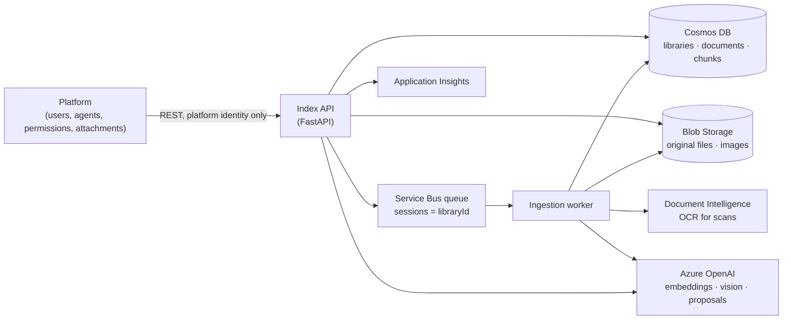

# Specification: File Library Index

*Version 0.4, 2026-10-22. Working name. Status: Phase 0 complete (the Cosmos configuration is proven at small scale); the application is not built. Every design choice here that rests on a measurement is traced in `evidence.md`.*

## 1. Scope

The File Library Index (the **index**) replaces Azure AI Search as the store and search engine behind the platform's file libraries. It:

- accepts files into libraries, extracts their text and image content, embeds it, and stores it in Azure Cosmos DB;
- serves search requests from agents, one library per request, with optional metadata filters;
- returns text chunks, citations and images an agent can put into its context.

It does **not** decide who may do what. The **platform** (the existing agent product) remains the system of record for users, agents, roles and which libraries are attached to which agent. The index enforces exactly one rule on its own: a personal library answers only the agent it was created for (§5).

One deployment of the index serves one organization. Each organization gets its own Cosmos account.

### Terms

| Term | Meaning |
|---|---|
| Library | A named collection of files with a description. Either `shared` or `personal`. |
| Shared library | Created on the admin side. The platform may attach it to any number of official agents. |
| Personal library | Created for one personal agent. Bound to that agent for life. |
| Document | One uploaded file. |
| Chunk | A searchable piece of a document: about 500 tokens of text, or the description of one image. |
| Generation | A counter on a document that increases each time it is reprocessed. Chunks carry the generation that wrote them. |
| Facet | A `key=value` tag string on a document and its chunks, used for filtering. |
| Platform | The existing product that owns users, agents, permissions and attachments, and calls the index. |

## 2. Architecture



Two processes from one codebase and one container image:

- **Index API**: every endpoint in §6. Writes uploads to Blob, records documents, enqueues work, and runs searches.
- **Ingestion worker**: consumes the queue and does all slow work: extraction, chunking, image description, embedding, writing chunks, purging.

The division of storage is deliberate. **Cosmos holds everything that is searched or reasoned over** (chunk text, vectors, metadata, document and library records). **Blob holds bytes that are handed back** (original files, extracted images). A Cosmos item is limited to 2 MB, and Blob storage costs a small fraction of Cosmos storage per GB.

## 3. Azure resources and identities

| Resource | Setting |
|---|---|
| Cosmos DB for NoSQL account | One per organization. Capability `EnableNoSQLVectorSearch`. `disableLocalAuth: true`. Session consistency. Continuous backup. Demo: add `EnableServerless`. Production: provisioned autoscale (§11). |
| Cosmos database | `fli`. No database-level throughput: vector containers cannot use shared throughput. |
| Containers | `libraries`, `documents`, `chunks`, defined exactly by `cosmos/*.json`. |
| Storage account | One blob container, `files`. Public blob access off. |
| Service Bus | Standard tier (sessions need it). Queue `ingest`, sessions enabled, max delivery count 5, dead-lettering on. |
| Azure OpenAI | Embedding deployment of `text-embedding-3-large` at 3,072 dimensions. A vision-capable chat deployment for image descriptions and proposals. |
| Document Intelligence | `prebuilt-read` for OCR of scanned PDFs and images. |
| Application Insights | Telemetry and the routing report (§9.3). |
| Container Apps | Two apps from one image: `api` and `worker`. Local runs are fine for the demo. |

All service-to-service calls use managed identity (`DefaultAzureCredential`). No keys or connection strings.

| Identity | Roles |
|---|---|
| API and worker (one user-assigned identity is fine) | Cosmos DB Built-in Data Contributor (data-plane role assignment on the account); Storage Blob Data Contributor and Storage Blob Delegator (to issue short-lived read links); Azure Service Bus Data Sender and Data Receiver; Cognitive Services OpenAI User; Cognitive Services User (Document Intelligence) |
| Platform service principal (production, Phase 5) | The app role `Platform.Caller` on the index's API app registration. Nothing else. The prototype uses the static key instead (§5 rule 1) |
| Operator (demo only, optional) | The same roles as the API and worker, so `scripts/canary.py` and local runs work under the operator's own sign-in. Granted by `infra/main.bicep` when `operatorPrincipalId` is set; leave it empty in production |

## 4. Cosmos data model

Three containers, however many libraries exist. A new container is justified only by a different permanent layout (partition key, vector settings); never by a new library, user or filter.

The exact definitions are in `cosmos/libraries.container.json`, `cosmos/documents.container.json` and `cosmos/chunks.container.json`. They are deployable as-is (for example with Bicep `loadJsonContent()` as the container `resource`). Rules that apply to all three:

- **Explicit indexing only.** The root is excluded and each queried field is included by name. Indexing everything by default can make the index larger than the data.
- **Partition-key paths are included explicitly.** With the root excluded, Cosmos does not index them on its own, and queries on them would scan.
- **Never list `/id/?` in `includedPaths`.** Cosmos accepts the container create and then fails it asynchronously, out of sight. `id` is always indexed anyway.
- **Vector settings are permanent.** Dimensions, data type, distance function, index type, quantizer and shard key cannot be changed after creation. A change means a new container, rebuilt from the stored chunk text and the original files.

### 4.1 `libraries`

Partition key `/libraryId`. `id` equals `libraryId` (a GUID).

| Field | Type | Notes |
|---|---|---|
| `id`, `libraryId` | string | GUID, assigned by the index |
| `kind` | `shared` \| `personal` | Immutable |
| `boundAgentId` | string | Personal only, required; absent on shared. Immutable |
| `name` | string | |
| `description` | string | What agents see as the tool description. Platform-editable |
| `descriptionProposal` | object | `{text, generatedAt, basedOnDocumentCount}`. Enhancement 1 |
| `autoAcceptTagProposals` | bool | Default `true` for personal, `false` for shared |
| `tagVocabulary` | object | `{key: {value: documentCount}}`, recomputed after ingestion |
| `stats` | object | `{documentCount, chunkCount, imageCount, lastIngestedAt}` |
| `embeddingModel`, `embeddingDimensions` | string, int | Recorded for rebuilds |
| `status` | `active` \| `deleting` | |
| `createdAt`, `createdBy`, `updatedAt` | | `createdBy` is the platform-supplied principal, for audit only |

### 4.2 `documents`

Partition key `/libraryId`. `id` equals `documentId` (a GUID).

| Field | Type | Notes |
|---|---|---|
| `id`, `documentId`, `libraryId` | string | |
| `fileName`, `contentType`, `fileType`, `sizeBytes`, `sha256` | | `fileType` is the normalized extension: `pdf`, `docx`, `pptx`, `xlsx`, `txt`, `md`, `html`, `csv`, `eml`, `msg`, `image` |
| `blobPath` | string | `{libraryId}/{documentId}/original/{fileName}` |
| `status` | `queued` \| `processing` \| `ready` \| `failed` \| `deleting` | The outcome of the latest processing attempt. It does not decide what search returns, except `deleting`; `activeGeneration` does (§8 step 6) |
| `statusDetail` | string | For `failed`: `encrypted`, `password_protected`, `unsupported_file_type`, `ocr_page_limit_exceeded`, `parser_error`, … |
| `activeGeneration` | int \| null | The generation search may return. `null` until the first generation commits, so a document's chunks are never searchable half-written |
| `pendingGeneration` | int \| null | The generation being written. The first upload sets it to 1 |
| `uploadedAt`, `uploadedBy` | | System time; `uploadedBy` for audit only |
| `authoredAt`, `authoredAtSuspect` | datetime, bool | From file metadata. `authoredAtSuspect` is set when many documents in the library share one timestamp, which marks a bulk migration rather than real authorship |
| `author` | string \| null | |
| `periodStart`, `periodEnd` | date \| null | The period the document is **about**. Not the upload or authoring date |
| `tags` | array | `[{key, value, source: "user" \| "accepted-proposal"}]` |
| `tagProposals` | array | `[{key, value}]` awaiting acceptance (enhancement 1) |
| `periodProposal`, `authorProposal` | | Same, for the typed fields |
| `facets` | string[] | `key=value` for every entry in `tags`; this is what filters match |
| `extraction` | object | `{method, ocrApplied, pageCount, extractionVersion, chunkingVersion}` |
| `chunkCount`, `imageCount`, `imagesSkipped` | int | |
| `updatedAt` | datetime | |

### 4.3 `chunks`

Hierarchical partition key `/libraryId` → `/documentId`. Vector shard key `/libraryId`. DiskANN index with the spherical quantizer, `indexingSearchListSize` 300, float16 vectors, cosine distance, 3,072 dimensions. Full-text index on `/text`, English.

Why this key: every search names one library, so `/libraryId` first sends a search straight to that library's data, and the shard key gives each library its own DiskANN graph. `/documentId` second makes everything about one document (reprocessing, deleting, fetching neighbouring chunks) a cheap single-partition operation, and keeps any logical partition far below Cosmos's 20 GB limit.

| Field | Type | Notes |
|---|---|---|
| `id` | string | `{documentId}:{generation}:{chunkIndex}`. Deterministic, so retries overwrite rather than duplicate |
| `libraryId`, `documentId`, `generation`, `chunkIndex` | | Text chunks are numbered 0…n−1 in reading order; image chunks follow, n…n+m−1 |
| `contentKind` | `text` \| `image` | |
| `text` | string | Chunk text; for images, the description (§7.5). Full-text indexed; returned to agents |
| `heading` | string \| null | Section heading carried into each chunk of its section |
| `location` | object | `{page}` \| `{slide}` \| `{sheet, rowStart, rowEnd}` \| `{}` |
| `imageRef` | string \| null | Blob path of the image, for `image` chunks |
| `imageMeta` | object \| null | `{width, height, mime}` |
| `fileName`, `fileType`, `uploadedAt`, `authoredAt`, `author`, `periodStart`, `periodEnd`, `facets` | | Copied from the document so filters run inside the vector search. Updated by patch when the document's metadata changes |
| `tokenCount` | int | |
| `embedding` | float[3072] | Stored as float16. Never returned by any query |
| `embeddingModel`, `chunkingVersion`, `createdAt` | | |

## 5. Permissions and the personal-library guarantee

The platform decides who may create, edit, attach and use libraries and agents, and it checks those permissions live, as it does today. **The index keeps no copy of those permissions.** A copy can go stale, and a stale permission leaks: if the index kept its own list of which agents may search a library, and that list lagged behind a detach in the platform, the detached agent could still search the library.

A fact that never changes cannot go stale, so the index holds exactly one: a personal library's `boundAgentId`.

**Rules:**

1. **Only the platform can call the index.** Agents and users never hold credentials to the index, so the `X-Agent-Id` header on a request can be trusted. **Production:** every request carries an Entra bearer token for the index's API app registration with the app role `Platform.Caller`, held only by the platform's service principal (Phase 5). **Prototype:** the platform is trusted by deployment. The API listens on the local machine and requires a static key (`AUTH_MODE=dev`, refused unless `ENVIRONMENT=local`). The platform authenticates its own users and decides who may see and add to which libraries, including exposing a personal library only to the agent it was created for; the index does none of that.
2. **Creating a library fixes its kind.** `kind: personal` requires `boundAgentId`; `kind: shared` forbids it. Neither field can change afterwards: `PATCH` with either returns `400 immutable_field`. Making a personal library shared means copying it into a new shared library (not in v1), never flipping the field.
3. **Search checks the binding.** Even though the platform exposes a personal library only to its own agent, the index re-checks as a backstop. Before searching, the index reads the library record (a point read, about 1 RU). It refuses when:
   - the library does not exist or is `deleting` → `404 library_not_found`;
   - the library is `personal` and `X-Agent-Id` ≠ `boundAgentId` → `403 library_not_bound_to_agent`, logged as a security event.
4. **The platform's attach screen for official agents lists only shared libraries** (`GET /v1/libraries?kind=shared`). Rule 3 is the backstop: a wrong attachment created by a platform bug returns nothing.
5. **Deleting refuses first and purges second.** `DELETE` sets `status: deleting` at once, so searches stop immediately; chunks, document records and blobs are purged in the background. The same holds per document (§7.8).

Shared libraries have no index-side binding check. Which official agents may search a shared library is entirely the platform's decision.

## 6. API

Base path `/v1`. JSON throughout except uploads. Errors: `{"error": {"code": "...", "message": "..."}}`.

### 6.1 Libraries

| Method and path | Body / query | Result |
|---|---|---|
| `POST /v1/libraries` | `{kind, boundAgentId?, name, description}` | `201` library |
| `GET /v1/libraries` | `?kind=shared\|personal&status=active` | List (for the platform's attach screen) |
| `GET /v1/libraries/{libraryId}` | | Library, including `descriptionProposal`, `tagVocabulary`, `stats` |
| `PATCH /v1/libraries/{libraryId}` | `{name?, description?, autoAcceptTagProposals?}` | Library |
| `DELETE /v1/libraries/{libraryId}` | | `202`; status `deleting` |
| `POST /v1/libraries/{libraryId}/description:propose` | | `202`; regenerates the proposal |
| `GET /v1/libraries/{libraryId}/tool` | | A ready-to-attach tool definition (§6.4) |

### 6.2 Documents

| Method and path | Body / query | Result |
|---|---|---|
| `POST /v1/libraries/{libraryId}/documents` | multipart: `file`, optional `metadata` JSON `{author?, periodStart?, periodEnd?, tags?}` | `202 {documentId, status: "queued"}` |
| `GET /v1/libraries/{libraryId}/documents` | `?status=&facet=` | List |
| `GET /v1/libraries/{libraryId}/documents/{documentId}` | | Document, including proposals |
| `PATCH /v1/libraries/{libraryId}/documents/{documentId}` | `{author?, periodStart?, periodEnd?, tags?, acceptProposals?: ["region=EMEA", "period", "author"]}` | Document; chunk metadata updated by a `retag` job |
| `PUT /v1/libraries/{libraryId}/documents/{documentId}/content` | multipart `file` | `202`; reprocesses as a new generation |
| `DELETE /v1/libraries/{libraryId}/documents/{documentId}` | | `202`; status `deleting` |
| `GET /v1/libraries/{libraryId}/documents/{documentId}/file` | | `302` to a 15-minute read-only link |

Uploads are refused with `409 library_deleting` when the library is `deleting`. Maximum upload size is configurable (default 100 MB).

### 6.3 Search

`POST /v1/libraries/{libraryId}/search`, header `X-Agent-Id: <agentId>` (required on every search).

```json
{
  "query": "What drove the change in gross margin in EMEA?",
  "filters": {
    "period": { "from": "2025-10-01", "to": "2025-12-31" },
    "authoredBetween": { "from": "2025-01-01", "to": "2026-03-31" },
    "uploadedBetween": null,
    "authors": ["Jane Doe"],
    "tags": ["region=EMEA"],
    "fileTypes": ["pdf", "pptx"],
    "contentKinds": ["text", "image"]
  },
  "top": 8,
  "includeNeighbors": true
}
```

Every filter is optional. Three time filters exist because "when" means three different things, and none substitutes for another:

- `period`: documents whose `periodStart`–`periodEnd` overlaps the window. This is what "documents about Q4 2025" means. Documents with no period are not matched, and the response says so.
- `authoredBetween`: `authoredAt` in the window.
- `uploadedBetween`: `uploadedAt` in the window.

`tags` must all match. `authors`, `fileTypes` and `contentKinds` match any listed value. `top` defaults to 8, maximum 20.

Response:

```json
{
  "library": { "libraryId": "…", "name": "Finance — Quarterly Reports" },
  "coverage": {
    "searched": "Finance — Quarterly Reports (412 documents)",
    "filtersApplied": { "period": "2025-10-01..2025-12-31", "tags": ["region=EMEA"] },
    "notes": ["Documents without a period set are not included when filtering by period."],
    "resultCount": 6,
    "disposition": "results"
  },
  "results": [
    {
      "rank": 1,
      "chunkId": "…",
      "documentId": "…",
      "fileName": "Q4-2025-EMEA-review.pptx",
      "location": { "slide": 7 },
      "heading": "Margin bridge",
      "contentKind": "text",
      "text": "…",
      "neighbors": [ { "chunkIndex": 11, "text": "…" }, { "chunkIndex": 13, "text": "…" } ],
      "image": null
    },
    {
      "rank": 2,
      "contentKind": "image",
      "fileName": "Q4-2025-EMEA-review.pptx",
      "location": { "slide": 8 },
      "text": "Bar chart titled 'Gross margin by region, Q4 2025'…",
      "image": { "url": "https://…?sv=…", "expiresAt": "…", "width": 1280, "height": 720, "mime": "image/png" }
    }
  ],
  "telemetryId": "…"
}
```

- `disposition` is `results` (3 or more), `thin` (1–2) or `empty` (0). An empty result is reported as empty; nothing is padded.
- No scores are returned. Hybrid ranking fuses rank positions, so its scores are not comparable across queries and must not be thresholded.
- `image.url` is a 15-minute read-only user-delegation SAS link. The platform fetches it to show the image to the user, and to put the image into the agent's context when the agent's model accepts images.

### 6.4 Tool definition

`GET /v1/libraries/{libraryId}/tool` returns a function-calling tool definition the platform attaches to an agent as-is. One tool per attached library.

```json
{
  "type": "function",
  "function": {
    "name": "search_library_finance_quarterly_reports",
    "description": "<library.description>\n\nFilters available in this library: tags region=(EMEA, APAC, NA), topic=(margin, headcount, capex); authors (Jane Doe, Sam Lee); documents cover periods 2024-01-01 to 2025-12-31; file types pdf, pptx, xlsx. Use 'period' for what a document is about, 'authoredBetween' for when it was written.",
    "parameters": {
      "type": "object",
      "properties": {
        "query": { "type": "string", "description": "What to look for, in natural language." },
        "period": { "type": "object", "properties": { "from": { "type": "string", "format": "date" }, "to": { "type": "string", "format": "date" } } },
        "authoredBetween": { "type": "object", "properties": { "from": { "type": "string", "format": "date" }, "to": { "type": "string", "format": "date" } } },
        "authors": { "type": "array", "items": { "type": "string", "enum": ["Jane Doe", "Sam Lee"] } },
        "tags": { "type": "array", "items": { "type": "string", "enum": ["region=EMEA", "region=APAC", "region=NA", "topic=margin", "topic=headcount", "topic=capex"] } },
        "fileTypes": { "type": "array", "items": { "type": "string", "enum": ["pdf", "pptx", "xlsx"] } }
      },
      "required": ["query"]
    }
  }
}
```

The tag and author values are an `enum` built from the library's actual vocabulary, so the agent picks real values instead of inventing them. When a library has more than 100 tag values, the enum is dropped and the description lists the 50 most used. The tool name is a slug of the library name, made unique per agent by the platform if needed. The platform maps a tool call back to `POST …/search` with the tool's `libraryId` and the calling agent's `X-Agent-Id`; the library is never an agent-supplied argument.

### 6.5 Search usage (enhancement 3)

`POST /v1/search-events/{telemetryId}/usage` with `{"usedChunkIds": ["…"]}`. Optional. The platform calls it after a turn to report which results the agent actually cited. `204`.

## 7. Ingestion

### 7.1 Queue

One Service Bus queue, `ingest`, with sessions enabled and `SessionId = libraryId`. Messages for one library are processed one at a time, in order; different libraries proceed in parallel up to `INGEST_MAX_CONCURRENT_SESSIONS` (default 8). This is the pacing mechanism: one user dropping 5,000 files into one library occupies one lane and cannot starve everyone else's uploads or searches.

| Message `type` | Fields | Effect |
|---|---|---|
| `ingest` | `libraryId, documentId, generation` | Process a document (§7.2) |
| `retag` | `libraryId, documentId` | Copy the document's metadata to its chunks by patch |
| `purgeDocument` | `libraryId, documentId, belowGeneration?` | Delete chunks (all, or older generations) |
| `purgeLibrary` | `libraryId` | Delete every document, chunk and blob, then the library |
| `proposeDescription` | `libraryId` | Regenerate the library description proposal |

A message whose `generation` is lower than the document's `pendingGeneration`/`activeGeneration`, or whose document is `deleting`, is completed without work. After the last delivery attempt fails, the worker marks the document `failed` with the reason before the message dead-letters. `activeGeneration` is left as it was: a failed replacement keeps the previous version searchable, and a failed first upload has nothing searchable.

### 7.2 Processing a document

1. Load the document; set `status: processing`, `pendingGeneration: G`.
2. Download the original from Blob.
3. Extract (§7.3). Encrypted, password-protected, unsupported and failed files end here with `status: failed` and a `statusDetail`.
4. Chunk the text (§7.4).
5. Extract and describe images (§7.5).
6. Propose tags, period and author (§9.1).
7. Embed every chunk's `text` with the embedding deployment, in batches of 16, honouring `Retry-After` on 429.
8. Upsert all chunks of generation G. Writes share one cap across the whole worker, `COSMOS_WRITE_CONCURRENCY` (default 2), not a cap per document. On a 429 that outlasts the SDK's own retries, wait `x-ms-retry-after-ms` and retry. Eight concurrent writers exhausted the SDK's retries on serverless within about 100 writes (`evidence.md` E10). Deterministic ids make retries safe.
9. Commit: set `activeGeneration: G`, `pendingGeneration: null`, `status: ready`, counts. Until this moment search keeps returning the previous generation, if any; from it, search returns generation G and ignores older ones (§8 step 6).
10. If G > 1, enqueue `purgeDocument` with `belowGeneration: G`.
11. Recompute the library's `tagVocabulary` and `stats` from the `documents` container (a single-partition query). Enqueue `proposeDescription` when the library has changed by 10 documents or 24 hours since the last proposal.

### 7.3 Extraction

| File type | Method |
|---|---|
| PDF | Text layer via `pypdf`, page by page. No text layer → Document Intelligence `prebuilt-read`, bounded by `OCR_MAX_PAGES` (default 200) |
| DOCX | `python-docx`: paragraphs with heading styles as section headings; tables as rows. Embedded images from `word/media/` |
| PPTX | `python-pptx`: one section per slide (title as heading), body text and speaker notes. Picture shapes as images, with slide number |
| XLSX, CSV | `openpyxl` / `csv`: one section per sheet; rows rendered as `Header: value` lines; header row repeated in every chunk |
| TXT, MD, HTML | Markdown headings / HTML headings as sections |
| EML | Python `email`: subject as heading, sender, recipients, date (as `authoredAt`), body. Attachment names listed in the text; attachments are not processed in v1 |
| MSG | `extract-msg`, same as EML |
| PNG, JPEG, GIF, WEBP, TIFF, BMP | Image path only (§7.5); OCR text from the vision description |
| Legacy DOC, PPT, XLS | `failed`, `unsupported_file_type` in v1 |

`authoredAt` and `author` come from document core properties (Office), PDF metadata, or email headers. Start from `src/fli/extraction.py` (§13), which already does native-first extraction with OCR fallback, detects encrypted and password-protected files, and records page, slide and sheet locations.

### 7.4 Chunking

Section-aware chunks of about 500 tokens with about 50 tokens of overlap, measured with the `cl100k_base` tokenizer (the one `text-embedding-3-large` uses). Overlap is whole trailing sentences; a sentence is split only if it alone exceeds the target. Headings are carried into every chunk of their section. An email of 700 tokens or fewer is one chunk. Spreadsheet chunks break on row boundaries. Start from `src/fli/chunking.py` (§13), and record `chunkingVersion` on every chunk.

### 7.5 Images

1. Collect standalone image uploads and images embedded in DOCX and PPTX. (PDF figures are Phase 5: Document Intelligence layout with figure output.)
2. Skip images with fewer than `IMAGE_MIN_PIXELS` total pixels (default 16,384, i.e. 128×128) or smaller than `IMAGE_MIN_BYTES` (default 10 KB): logos, icons, bullets. Cap at `IMAGE_MAX_PER_DOCUMENT` (default 50). Record `imagesSkipped`.
3. Store each kept image at `{libraryId}/{documentId}/images/{imageId}.{ext}`.
4. Describe it with the vision deployment. Prompt: describe what the image shows for someone searching for it; transcribe any visible text, numbers, labels, axis titles and legends; for charts, state the chart type, what is compared and the main trend; do not speculate beyond what is visible. Give it the document name and the nearest heading or slide title as context.
5. The chunk `text` is `"Image from <fileName>, <location>, under '<heading>': <description>"`, `contentKind: image`, with `imageRef` and `imageMeta`. It is embedded with the same model as text, so one search covers both.

Describing and then embedding keeps one vector space, lets keyword search work on images, and gives a text-only agent something useful to read. A vision call per image is the largest per-file cost in the pipeline, which is why the skip rules and cap exist.

### 7.6 Concurrency and throttling

Cosmos throttles with HTTP 429 when a partition's throughput is exceeded. The SDK retries; the worker additionally retries 429s that outlast the SDK's retries, and backs off on repeated ones. Ingestion is the expensive side (about 144 RU per chunk written at float16, `evidence.md` E10), so the session lanes (§7.1) decide which library's work runs next, and the worker-wide write cap (§7.2 step 8) keeps ingestion below the container's ceiling, leaving room for searches. On a provisioned account, raise `COSMOS_WRITE_CONCURRENCY` with the configured throughput.

### 7.7 Metadata changes

`PATCH` on a document updates the document record at once, then enqueues `retag`, which patches `facets`, `author`, `periodStart` and `periodEnd` on every chunk of the active generation (a single-partition query by `libraryId` + `documentId`, then partial-update operations). A few hundred small writes per document.

### 7.8 Deletion and replacement

- **Document delete:** set `status: deleting` (search drops its chunks immediately, §8 step 6), then `purgeDocument`, then delete the blob and the document record.
- **Replacement (`PUT …/content`):** new blob version, `generation + 1`, `ingest`. The old generation stays searchable until the new one commits, then is purged.
- **Library delete:** set `status: deleting` (search refused immediately, §5), then `purgeLibrary`.

## 8. Search execution

1. Authenticate the platform (§5 rule 1). Validate the body.
2. Point-read the library. Apply §5 rule 3.
3. Embed `query` with the embedding deployment (3,072 floats). **Convert it for the float16 index:** round each value to float16, and set every value whose magnitude is below 2⁻¹⁴ (float16's subnormal range) to 0. The service returns no distance for a float16 query that contains a subnormal.
4. Extract lexical terms: lower-cased alphanumeric tokens, de-duplicated, at most 16.
5. Run one hybrid query against `chunks`:

```sql
SELECT TOP {fetch}
  c.id, c.documentId, c.generation, c.chunkIndex, c.contentKind, c.text, c.heading,
  c.location, c.imageRef, c.imageMeta, c.fileName, c.fileType
FROM c
WHERE c.libraryId = @libraryId
  {AND filter clauses}
ORDER BY RANK RRF(
  VectorDistance(c.embedding, @queryVector, false, {'dataType': 'float16'}),
  FullTextScore(c.text, @t0, @t1, …)
)
```

   - `{fetch}` = `min(2 × top, 40)`, rendered into the SQL as a validated positive integer. Every vector or hybrid query has a `TOP`; without one Cosmos may read far more than it needs.
   - `{'dataType': 'float16'}` must match the stored type. Declaring `float32` against a float16 index makes Cosmos scan instead of using the index (`evidence.md` E8).
   - With no lexical terms, use `ORDER BY VectorDistance(…)` alone.
   - Leave `searchListSizeMultiplier`, `filterPriority` and RRF weights at their defaults until measured.
   - `c.libraryId = @libraryId` is always an equality on one value. Searching several libraries is several requests, never `IN` or `OR` across libraries.
   - Never select `c.embedding`.

   Filter clauses:

| Filter | Clause |
|---|---|
| `period` | `c.periodStart <= @pTo AND c.periodEnd >= @pFrom` |
| `authoredBetween` | `c.authoredAt >= @aFrom AND c.authoredAt < @aTo` |
| `uploadedBetween` | `c.uploadedAt >= @uFrom AND c.uploadedAt < @uTo` |
| `authors` | `c.author IN (@au0, @au1, …)` |
| `tags` | `ARRAY_CONTAINS(c.facets, @tag0) AND ARRAY_CONTAINS(c.facets, @tag1) …` |
| `fileTypes` | `c.fileType IN (…)` |
| `contentKinds` | `c.contentKind IN (…)` |

6. **Check generations.** Collect the distinct `documentId`s in the results and point-read their document records (same partition, about 1 RU each, in parallel). Drop any chunk whose document is missing or `deleting`, or whose `generation` ≠ `activeGeneration`. Status is otherwise ignored: while a replacement is `queued` or `processing`, or after it has `failed`, the previous generation is still the active one and stays searchable (§7.8). This hides replaced and deleted documents the moment their record changes, before the background purge runs. Keep the first `top`.
7. **Neighbours** (when `includeNeighbors`, text results only): one query per document, scoped to the full partition key, for `chunkIndex` ± 1 in the active generation.
8. **Images:** for `image` results, issue a 15-minute read-only user-delegation SAS link to `imageRef`.
9. **Coverage:** fill `coverage` (§6.3), including notes for filters that exclude documents lacking the field.
10. Emit the `library_search` telemetry event (§9.3). Return.

Results are ordered by the fused rank Cosmos returns. Repeated identical searches can return slightly different top results, because each Cosmos replica builds its own index. Tests compare against exact-search references with recall, never against fixed result lists. Only vector-only searches have an exact reference: inside `RRF`, the brute-force flag changes nothing (`evidence.md` E24).

The vector index engages minutes after writes (`evidence.md` E25). Until it does, searches on newly written chunks still return correct results, but scan the library and cost accordingly. Nothing in search waits for the index.

## 9. Enhancements

### 9.1 Proposed descriptions and tags

- **Per document**, during ingestion: one chat call on the document's opening text (about 3,000 tokens) plus the library's current tag vocabulary. Output, as JSON: `period {start, end} | null`, `author | null`, `tags [{key, value}]`. The prompt tells the model to reuse existing keys and values where they fit, and to propose a period only when the document states or clearly implies the period it covers. Proposals land in `tagProposals`, `periodProposal` and `authorProposal`. If the library has `autoAcceptTagProposals`, they are accepted at once with `source: accepted-proposal`; otherwise they wait for a user in the library UI.
- **Per library**: `proposeDescription` sends the library name, current description, tag vocabulary and a sample of document titles and opening lines (up to 30 documents). Output: a 2–4 sentence description stating what the library contains, which periods, regions or topics it covers, and what it should not be used for. It lands in `descriptionProposal`; an admin or the owner accepts or edits it. It never overwrites `description` on its own.

Accepted values keep their source on the document record, so a user-entered tag and an accepted AI proposal stay distinguishable.

### 9.2 Coverage disclosure

Every search response carries `coverage` (§6.3): what was searched, which filters applied, how many results, a disposition, and notes on anything a filter excluded. An empty result says it is empty. This lets an agent read a thin result as "try another library or relax a filter" rather than "the answer does not exist."

### 9.3 Routing telemetry

Every search emits an Application Insights custom event `library_search`: `telemetryId, libraryId, libraryKind, agentId, filterKeys, top, resultCount, disposition, requestCharge, cosmosMs, totalMs`. **Query text and chunk text are not logged**: personal libraries hold personal content. `search_usage` events (§6.5) add `telemetryId, usedCount`.

The routing report is a saved Log Analytics query, per library over 30 days: searches, empty rate, thin rate, and usage rate (searches whose results were cited). A library that is searched often and rarely used, or often empty, has a description that is steering agents wrong. `GET /v1/libraries/{libraryId}/routing-report` (Phase 4) returns the same figures through the API.

## 10. Configuration

| Variable | Default | Notes |
|---|---|---|
| `ENVIRONMENT` | — | `local`, `demo` or `prod` |
| `AUTH_MODE` | `entra` | `dev` accepts a static key from `DEV_API_KEY`; the API refuses to start in `dev` mode unless `ENVIRONMENT=local`. `entra` is not built until Phase 5: the API refuses to start in it |
| `API_AUDIENCE`, `API_TENANT_ID`, `CALLER_APP_ROLE` | —, —, `Platform.Caller` | Phase 5 (`entra` mode) |
| `COSMOS_ENDPOINT`, `COSMOS_DATABASE` | —, `fli` | |
| `BLOB_ACCOUNT_URL`, `BLOB_CONTAINER` | —, `files` | |
| `SERVICEBUS_NAMESPACE`, `SERVICEBUS_QUEUE` | —, `ingest` | |
| `AOAI_ENDPOINT`, `AOAI_EMBEDDING_DEPLOYMENT`, `AOAI_EMBEDDING_DIMENSIONS` | —, —, `3072` | The dimension must equal the container's vector policy; the app checks at startup |
| `AOAI_VISION_DEPLOYMENT`, `AOAI_CHAT_DEPLOYMENT` | — | Can be the same deployment |
| `DOCINTEL_ENDPOINT`, `OCR_MAX_PAGES` | —, `200` | |
| `UPLOAD_MAX_BYTES` | `104857600` | |
| `IMAGE_MIN_PIXELS`, `IMAGE_MIN_BYTES`, `IMAGE_MAX_PER_DOCUMENT` | `16384`, `10240`, `50` | |
| `INGEST_MAX_CONCURRENT_SESSIONS` | `8` | |
| `COSMOS_WRITE_CONCURRENCY` | `2` | Chunk writes in flight across the whole worker (§7.2 step 8). 2 suits serverless (`evidence.md` E10) |
| `SEARCH_DEFAULT_TOP`, `SEARCH_MAX_TOP` | `8`, `20` | |
| `APPLICATIONINSIGHTS_CONNECTION_STRING` | — | |

## 11. Capacity and cost

**Demo:** a serverless account. It costs nothing when idle. A serverless container in the source measurements topped out near 1,785 RU/s, about 22 chunk writes per second, shared between ingestion and searches.

**Production:** provisioned autoscale. Two reasons: serverless's ceiling cannot be raised, so a large admin upload would slow every agent's searches in the organization for its duration; and serverless carries no SLA. Autoscale bills each hour at the highest throughput used, with a floor of 10% of the configured maximum. Starting points to tune: `chunks` 4,000 RU/s maximum, `documents` and `libraries` 1,000 each. A serverless account converts to provisioned one way only, so the demo account can be promoted.

**Measured unit costs** (serverless at about $0.25 per million RU; see `evidence.md`). "Source" is the earlier project: float32 vectors, 600,000 chunks on one physical partition. "Phase 0" is this project's canary: this exact configuration, one 1,500-chunk library.

| Item | Figure |
|---|---|
| Storage | Source: about 17.9 GB per million chunks at float32. float16 cut storage by 46%, so about 9.7 GB per million |
| Writing | Phase 0: about 144 RU per chunk at float16, full-text index included, so about $36 per million chunks. Source: 91 RU at float32 |
| Searching | Phase 0: about 15 RU per vector search on a 1,500-chunk library once the index engages, 114 RU before; about 4 RU per hybrid search. Source: about 7 RU typical, 54–69 RU at p95, on libraries up to 100,000 chunks |

Azure OpenAI calls (embeddings, image descriptions, proposals) are billed separately and will likely exceed the Cosmos cost.

## 12. Not in v1

- Searching several libraries in one request, or ranking results from different libraries against each other. The agent searches each library through its own tool.
- Organization-wide search across all shared libraries without choosing. It would need a second container with a different shard key.
- Per-user permissions inside the index.
- PDF figure extraction; email attachments as child documents; legacy Office formats.
- Multimodal (image) embeddings. Possible later as a second vector path, which is a container-creation decision.
- The Cosmos semantic reranker (preview).
- Keyword search in languages other than English (Cosmos multi-language full text is preview). Vector search works across languages.
- Multi-region.
- Converting a personal library to shared.

## 13. Inherited code

These modules were carried over from earlier work on these Cosmos features and moved into the application package in Phase 1, with their tests.

| Path | Use |
|---|---|
| `src/fli/extraction.py` | Native-first extraction for DOCX, PPTX, XLSX, CSV, PDF, Markdown, HTML, EML; encrypted and password-protected detection; OCR fallback; page, slide, sheet and row locations; author and date metadata |
| `src/fli/docintel.py` | Document Intelligence `prebuilt-read` client with bounded pages and failure mapping |
| `src/fli/chunking.py` | The section-aware 500/50 chunker with versioning and locations |
| `src/fli/embedding.py`, `governor.py`, `http.py` | Batched Azure OpenAI embeddings with `Retry-After` handling and workload pacing |
| `src/fli/query.py` | The §8 search SQL, the float16 query conversion, and `check_query` enforcing the invariants |
| `infra/` | Account and container Bicep; containers load `cosmos/*.json` |
